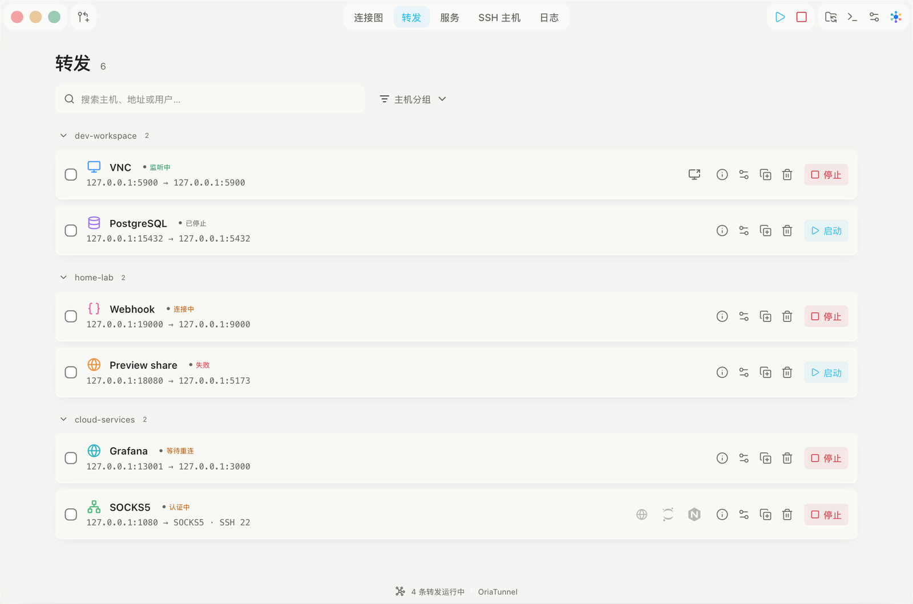

  <picture>
    <source media="(prefers-color-scheme: dark)" srcset="docs/assets/oriatunnel-logo-dark.svg">
    
  </picture>

<h1 align="center">一个 SSH 工作区，简化远程管理</h1>

OriaTunnel 将 SSH 隧道、远程服务、终端、文件传输和远程桌面集中在一个可视化工作区。

  简体中文 · <a href="docs/readme/README.zh-TW.md">繁體中文</a> · <a href="docs/readme/README.en.md">English</a> · <a href="docs/readme/README.ja.md">日本語</a> · <a href="docs/readme/README.ko.md">한국어</a> · <a href="docs/readme/README.de.md">Deutsch</a> · <a href="docs/readme/README.fr.md">Français</a> · <a href="docs/readme/README.ru.md">Русский</a>

**[下载安装](#下载与安装)** · [快速上手](#快速上手) · [使用指南](docs/USAGE.md) · [在线演示](https://oriamade.com/zh-CN/oria-tunnel#workspace)

## 核心功能

### 🔗 可视化隧道管理

- 在连接图上查看本机、SSH 主机和转发端口的关系。规则可单独或批量启停，连接状态、活动连接数和流量随运行情况更新。
- 从已有 SSH 配置中选择主机，或手动添加。支持密码、私钥、系统 SSH Agent 和多跳连接（ProxyJump）。
- 保存常用规则后，下次即可从连接图打开内网网页，或用本机数据库客户端连接转发端口。

### ⚙️ 远程服务管理

- 把服务的启动、停止、重启、状态查询和日志命令保存为模板。将模板与转发关联后，即可从服务菜单执行相应操作。
- 对于需要先启动的服务，可配置启动命令和健康检查。使用「启动并连接」时，可以逐步查看远程命令、服务检查和隧道连接的结果。

### 💻 本地与 SSH 智能终端

- 在标签页之间切换本地和远程会话。输入时可查看补全建议，用 ↑ 找回历史命令，或按关键词从跨会话命令库调出常用命令。
- 用 Shift+Enter 编辑多行命令。切换目录时保留输入草稿，执行后可按命令折叠长输出、单独复制命令或结果。

### 📁 可视化文件传输

- 在两个面板中并排浏览本机与远程目录，拖放即可批量上传或下载。两个面板也可以分别打开不同的 SSH 主机，直接在主机间传输。
- 在后台队列中查看每批文件的进度，暂停、继续或取消任务。需要检查内容时，可直接预览文件或编辑文本。

### 🖥️ VNC 远程桌面

- 从 VNC 转发打开独立桌面窗口，通过 SSH 隧道访问远端图形界面。支持全屏、缩放，以及本机与远端之间的双向文本剪贴板。
- 在桌面窗口内打开 SSH 终端或通过 SFTP 收发文件。关闭桌面窗口后，已提交的文件传输会继续运行。

## 下载与安装

| 平台 | v0.4.0 安装包 | 安装方式 |
| --- | --- | --- |
| macOS | [Apple Silicon](https://github.com/KrisLee1/OriaTunnel/releases/download/v0.4.0/OriaTunnel_0.4.0_aarch64.dmg) · [Intel](https://github.com/KrisLee1/OriaTunnel/releases/download/v0.4.0/OriaTunnel_0.4.0_x64.dmg) | 打开磁盘映像，将 OriaTunnel 拖入「应用程序」。 |
| Windows | [x64](https://github.com/KrisLee1/OriaTunnel/releases/download/v0.4.0/OriaTunnel_0.4.0_x64-setup.exe) · [ARM64](https://github.com/KrisLee1/OriaTunnel/releases/download/v0.4.0/OriaTunnel_0.4.0_arm64-setup.exe) | 运行安装程序，按向导完成安装。 |

### 版本记录

**v0.4.0** 更新了本地与 SSH 智能终端，加入命令补全、跨会话命令库、多行编辑和长输出折叠。已安装的用户可在「关于」中检查更新。

[本版更新说明](docs/releases/v0.4.0.md) · [所有版本](https://github.com/KrisLee1/OriaTunnel/releases)

## 快速上手

假设网页服务已在 SSH 服务器的 `3000` 端口运行，通过以下三步即可从本机访问。

1. **添加主机**。点击「添加主机」，从 SSH 配置中选择主机，或手动填写地址、端口和用户名。
2. **创建转发**。点击「新建转发」，选择该主机和「本地转发（L）」。本机监听填 `127.0.0.1:13000`，目标填 `127.0.0.1:3000`（SSH 服务器自身）。
3. **打开网页**。点击「保存并启动」，按提示核对服务器指纹并完成认证。规则显示「监听中」后，在本机浏览器打开 `http://127.0.0.1:13000`。

下次使用时，直接启动已保存的规则即可。如果规则已显示「监听中」但网页打不开，请先确认远端服务已启动，并检查目标端口。[查看状态与排查问题](docs/USAGE.md#查看状态与排查问题)

### 如何选择转发方式

| 想做什么 | 转发方式 | 从哪里访问 |
| --- | --- | --- |
| 在本机打开内网网页、数据库或 VNC 桌面 | 本地转发（L） | 浏览器或客户端连接本机监听端口 |
| 让服务器访问本机正在开发的服务 | 远程转发（R） | 在服务器上连接远端监听端口 |
| 通过同一台 SSH 主机访问多个内网地址 | 动态代理（D） | 打开独立代理浏览器，或让客户端使用本机 SOCKS5 代理 |

如果团队已经准备好主机和规则，可从转发页选择「导入配置」，预览后补全自己的认证信息。导入的服务模板需核对命令并启用后才能执行。[使用现成配置](docs/USAGE.md#使用现成配置)

## 界面预览

以下为官网演示使用的示例数据，图片随深浅主题切换。

| <picture><source media="(prefers-color-scheme: dark)" srcset="docs/assets/screenshots/connection-map-dark.png"></picture> | <picture><source media="(prefers-color-scheme: dark)" srcset="docs/assets/screenshots/terminal-dark.png"></picture> |
| :---: | :---: |
| <picture><source media="(prefers-color-scheme: dark)" srcset="docs/assets/screenshots/files-dark.png"></picture> | <picture><source media="(prefers-color-scheme: dark)" srcset="docs/assets/screenshots/vnc-dark.png"></picture> |

更多界面：转发列表、服务、主机与活动日志

| <picture><source media="(prefers-color-scheme: dark)" srcset="docs/assets/screenshots/forwards-dark.png"></picture> | <picture><source media="(prefers-color-scheme: dark)" srcset="docs/assets/screenshots/services-dark.png"></picture> |
| :---: | :---: |
| <picture><source media="(prefers-color-scheme: dark)" srcset="docs/assets/screenshots/hosts-dark.png"></picture> | <picture><source media="(prefers-color-scheme: dark)" srcset="docs/assets/screenshots/logs-dark.png"></picture> |

## 文档与支持

[使用指南](docs/USAGE.md) · [常见问题与排错](docs/USAGE.md#查看状态与排查问题) · [开发指南](docs/DEVELOPMENT.md) · [反馈问题](https://github.com/KrisLee1/OriaTunnel/issues)

## 许可证

Copyright (C) 2026 KrisLee. 本项目采用 [GPL-3.0-only](LICENSE)。[第三方许可声明](docs/licenses)
