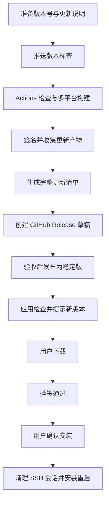

# OriaTunnel 应用更新方案

状态：应用接入与发布工作流已实现；四架构云端检查、签名、构建和草稿汇总全部通过。v0.1.0 尚未公开发布，正式跨版本安装验收待完成。更新日期：2026-10-25。

本文保存 Tauri Updater + GitHub Releases + GitHub Actions 的应用更新方案。应用接入实现见下文，方案其余内容不授权提交、推送、配置线上密钥或公开发布。实际实现与验收以 [项目状态](PROJECT_STATUS.md) 和源码为准。

## 发布流水线实现（2026-10-25）

新增 Quality gates、Build release draft 和 Publish verified release 工作流，复用独立签名预检与验签工具。四个平台独立构建，完成前端/原生检查后汇总单一清单；macOS 先公证装订最终 App/DMG，再对专用 TAR 做版本绑定签名。公开发布前重新下载并验签草稿，拒绝不完整、同版/旧版或源提交不匹配的版本。当前 Secrets 验证、运行证据及未完成项以 [项目状态](PROJECT_STATUS.md) 为准；操作入口、必需 Secrets 与产物约定统一见 [发布指南](RELEASING.md)。

## 应用接入实现（2026-10-24）

- Rust `src-tauri/src/updater.rs` 使用锁定的 `tauri-plugin-updater 2.14.0` 管理检查、下载、验签、偏好、安装和递增修订快照；前端通过业务 IPC 及 `tunnel://update` 获取状态，不直接开放插件安装权限。
- 已配置用户提供的更新公钥和稳定版 Releases 入口；仅接受更高版本的正式版本及 HTTPS 产物地址。启用 `requireSignedVersion`，要求签名绑定清单版本；后续发布构建需使用支持该功能的锁定 CLI，手动签名时传入正确的 `--app-version`。
- 顶栏设置按钮外侧通过透明 SVG Avatar 打开「关于 OriaTunnel」，有更新时 AvatarBadge 显示右上角纯色圆点，随窗口控件位置镜像。关于弹窗展示应用图标、名称、真实版本、`© 2026 KrisLee`、官网/GitHub/作者首页入口，以及检查、下载、进度、说明、安装确认、错误重试和启动检查偏好，使用独立 `updater` 命名空间覆盖八语言。启动检查一次，后台网络失败不弹错误；缺少公钥、开发构建或不支持的安装形态禁用更新。
- 安装前重验签名，重新核对确认时的活动任务集合，再阻止启动并等待转发与主机测试清理；失败释放更新门禁，不重新连接已停止的会话，也不重置真正退出的永久关闭标记。
- Windows 覆盖插件默认的同步退出前清理钩子：异步 SSH 清理由应用先等待完成，避免插件提前销毁 Tauri 资源后，安装器启动失败却无法恢复界面。macOS 安装成功后通过现有退出协调器请求重启。
- 更新启动偏好独立原子保存到应用数据目录 `update-preferences.json`；损坏时暂停后台检查并提示，不在读取时覆盖原文件。下载包仅留在当前 Rust 进程内，退出后需重新下载。
- 普通本地构建默认不生成签名更新包，避免要求开发者持有私钥。后续发布构建通过 `src-tauri/tauri.updater.conf.json` 覆盖启用 `createUpdaterArtifacts`；相关构建说明见 [开发指南](DEVELOPMENT.md#应用更新开发)。

本轮不配置 GitHub Actions、发布 Secrets 或平台签名，不读取发布私钥，不发布版本。隔离下载验签及门禁测试不等于两个正式版本间的安装验收；Windows 真机安装、macOS 两种架构的完整升级与系统权限仍需后续验证。

## 1. 目标与当前基础

使用 GitHub Actions 构建并签名，GitHub Releases 托管安装包与更新清单，Tauri Updater 负责检查、下载、验签和安装。第一期只提供稳定版更新，用户确认后安装，不在后台自动中断转发；无需部署独立更新服务器。

方案制定时的源码基础：

- Tauri 锁定版本为 2.12.5，应用版本为 `0.1.0`。
- Windows 已有 NSIS 安装器配置和 `pnpm package:win`。
- macOS 已有 App、DMG 和保留 Finder 图标元数据的 DMG ZIP 打包脚本 `scripts/package-mac.sh`。
- 尚未接入 Updater 插件或 GitHub Actions 工作流。
- Rust 已有退出清理、会话取消和单实例锁，需将更新安装纳入同一生命周期管理。

## 2. 总体流程



使用静态 `latest.json`。应用检查稳定版入口，清单内的产物 URL 固定指向具体版本标签，避免版本与下载文件错配。Tauri 支持该静态清单方式，详见 [Updater 文档](https://v2.tauri.app/plugin/updater/)。

## 3. 发布目标与产物

建议构建以下三个目标；只有完成对应设备验收的平台才进入正式更新清单。

| 平台 | 手动安装产物 | 应用内更新产物 |
| --- | --- | --- |
| Windows x64 | NSIS `setup.exe` | NSIS 安装器及 `.sig` |
| macOS Apple Silicon | DMG、现有 DMG ZIP | `.app.tar.gz` 及 `.sig` |
| macOS Intel | DMG、现有 DMG ZIP | `.app.tar.gz` 及 `.sig` |

macOS 现有 ZIP 包装的是 DMG，用于保留 Finder 图标，不能直接作为 App 更新压缩包。Windows 第一期自动更新只面向 NSIS 安装版；独立 EXE 用户先手动安装带更新功能的版本。产物格式以 [Tauri 构建说明](https://v2.tauri.app/plugin/updater/#building) 及实施时锁定的插件版本为准。

## 4. 应用内交互

顶栏设置按钮外侧增加 Avatar 关于入口，有更新时显示右上角纯色圆点；点击「关于 OriaTunnel」展示应用信息、版权及外链，并在「版本更新」中提供检查结果、更新说明、真实下载进度和错误，以及「检查更新」「下载更新」「安装并重启」「稍后」。新版本通知使用应用 Logo、Badge 版本号及「去更新」按钮，点击关闭通知并打开关于弹窗。复用现有组件与弹窗，同步八语言文案。

建议行为：

- 默认启动后后台检查一次，允许关闭自动检查。
- 后台检查失败保持安静，手动检查失败则明确反馈，并提供 Releases 手动下载入口。
- 下载和验签期间保持现有转发运行，失败可重试，不改变连接状态。
- 安装前展示正在运行的转发数量，明确说明安装会中断全部 SSH 转发。
- 更新完成后沿用现有启动及自动连接规则，不额外恢复临时会话或保存认证信息。

不提供强制更新、预发布通道、静默安装或自动降级；后续如有需要另行设计。

## 5. Rust 更新状态与退出管理

建议在 Rust 调用 Updater，由现有 IPC 向前端提供更新快照、事件及真实下载进度；前端不直接持有可绕过会话清理的安装入口。

状态流程：

```text
空闲 → 检查中 → 有更新 → 下载中 → 待安装 → 清理会话 → 安装
                    ↘ 失败，可重试
```

注册 `tauri-plugin-updater`，启用 `bundle.createUpdaterArtifacts`，配置公钥与更新入口。前端只调用业务命令，按实际调用方式设置最小权限；不因使用 Rust 插件而直接开放前端完整安装权限。

### 安装顺序

1. 下载并验签通过。
2. 用户确认安装。
3. 阻止新的转发启动、主机测试和重连，包括托盘、批量操作及其他并发入口。
4. 取消并等待现有会话和主机测试清理完成。
5. 调用更新安装，按平台完成退出和重新启动。

Windows Updater 会在安装时直接退出进程，不能只依赖现有 `ExitRequested` 处理器。官方提供退出前钩子，但异步 SSH 清理应在调用安装前完成，不能仅在同步钩子中启动异步任务。参见 [Windows 退出前钩子](https://v2.tauri.app/plugin/updater/#windows-before-exit-hook) 与 [插件源码](https://github.com/tauri-apps/plugins-workspace/blob/v2/plugins/updater/src/updater.rs)。

当前 `AppState::shutdown()` 会永久设置关闭标记。实施时需提取共享清理能力，建立可恢复的更新准备流程：若安装器未能启动，应恢复旧应用接受操作的能力并显示错误；已停止的转发不擅自重新连接。清理未完成时不得继续安装。macOS 重启需核对现有退出处理与单实例锁释放顺序。

## 6. GitHub Actions

建议拆成两个工作流：

| 工作流 | 触发方式 | 职责 |
| --- | --- | --- |
| `ci.yml` | PR、分支更新 | 类型检查、前端测试、Rust 检查与隔离测试 |
| `release.yml` | `v*` 标签、手动触发 | 校验版本、构建签名、汇总产物、生成 Release 草稿 |

发布约束：

- 标签、`package.json`、Cargo 与 Tauri 版本必须一致，锁文件按需同步。
- 固定 Node、pnpm、Rust 和 Actions 版本，使用锁文件安装依赖；实施时验证插件最低 Rust 版本。
- 各平台独立构建，使用官方 `tauri-action` 负责构建，产物汇总和发布由后续单独任务完成。
- 由一个汇总任务生成完整 `latest.json`，不让多个构建任务并发覆盖同名清单。
- 汇总时校验版本、架构、签名、文件存在性及重复资产；缺少任一要求的平台或检查失败时，不发布稳定版。
- 先创建并上传 Release 草稿，验收后再发布并设为 Latest；普通分支更新不触发正式发布。
- 构建任务使用最小权限，只有发布任务需要 `contents: write`；签名密钥仅向受信任的发布任务提供，不暴露给外部 PR。

`tauri-action` 支持仅构建及关闭自动上传更新清单。具体输入以实施时固定版本的 [Action 文档](https://github.com/tauri-apps/tauri-action) 为准。

## 7. 更新地址与清单

如果使用当前仓库的公开 Releases，入口为：

```text
https://github.com/KrisLee1/OriaTunnel/releases/latest/download/latest.json
```

仓库是否适合公开提供资产需在接入时确认；若源码仓库为私有，建议使用独立公开发布仓库，客户端不内置 GitHub Token。

`latest.json` 包含版本、更新说明、发布时间，以及每个平台对应的下载地址和签名正文。签名字段使用 `.sig` 文件内容，不是签名文件路径或 URL。清单平台键、产物格式与锁定的 Updater 版本保持一致，并用实际构建产物验证。

稳定版保持版本递增；预发布版本不得进入稳定版入口。发布后的更新资产保持不变，需要修复时发布新版本。

## 8. 签名与密钥

两种签名分别处理：

| 签名 | 作用 | 建议 |
| --- | --- | --- |
| Tauri 更新签名 | 验证更新包可信且未被修改 | 必须启用 |
| 平台代码签名 | 操作系统验证应用发布者 | macOS 正式分发配置 Developer ID 与公证；Windows 配置代码签名 |

Tauri 公钥随应用发布；`TAURI_SIGNING_PRIVATE_KEY` 与 `TAURI_SIGNING_PRIVATE_KEY_PASSWORD` 保存在 GitHub Secrets，私钥另做离线备份，不进入仓库、日志或构建产物。私钥丢失会影响已有安装用户的后续更新；密钥轮换需提前设计过渡版本。参见 [更新签名说明](https://v2.tauri.app/plugin/updater/#signing-updates)。

Tauri 更新签名不能替代系统代码签名。Windows 即使完成代码签名，也不能保证立即消除 SmartScreen 提示。参见 [macOS 签名与公证](https://v2.tauri.app/distribute/sign/macos/) 和 [Windows 签名](https://v2.tauri.app/distribute/sign/windows/)。

macOS 需梳理现有 DMG 图标后处理与签名、公证的顺序，确保最终发布文件完成处理后再验证；App 完成签名、公证及相关处理后生成更新压缩包，对最终压缩包生成 Tauri 签名，之后不再修改该压缩包。

## 9. 实施阶段与验收

| 阶段 | 交付内容 | 验收重点 |
| --- | --- | --- |
| 应用接入 | Rust 更新模块、IPC、设置入口、八语言文案 | 检查、下载、失败重试、安装前清理 |
| 发布流水线 | 多平台构建、签名、清单汇总、Release 草稿 | 版本一致、产物完整、失败不发布 |
| 更新演练 | 两个连续版本的完整升级 | 配置保留、单实例、托盘、重启、平台权限 |

预计修改范围为 Tauri 配置与依赖、Rust 更新及退出模块、设置页和翻译、发布工作流、打包辅助脚本及开发文档。

验收使用独立应用标识、隔离配置和回环 SSH；release 构建不能仅依赖现有仅供 debug 使用的数据目录环境变量隔离。不得连接用户真实 SSH 主机、读取真实认证信息或替换用户正在使用的应用。

必须覆盖：

- 无更新、有更新、网络不可用、清单损坏、缺少目标平台、错误签名、下载中断及重试。
- 重复点击、并发检查/下载/安装、清理期间从托盘或其他入口尝试启动转发。
- 运行转发及主机测试时升级，清理失败不安装，安装器启动失败后的旧应用恢复操作。
- 更新后配置、布局与偏好保留，凭据不进入更新产物或日志。
- Windows NSIS 升级、安装路径与权限、重新启动和单实例行为。
- macOS 两种架构的升级、签名与公证、单实例锁，以及从 DMG 直接运行或应用目录不可写时的提示。
- 深浅主题、键盘操作、最小窗口、八语言文案与真实进度展示。

若后续版本涉及配置格式变化，应先备份并设计兼容读取或迁移失败恢复，不将其隐含在更新安装中。Tauri Updater 不等于完整的事务式安装回滚系统，本期不承诺安装失败后的自动回滚。

## 10. 首次接入与坏版本处理

当前不含 Updater 的 `0.1.0` 需要用户手动安装一次带更新功能的版本，此后才能应用内更新。

坏版本优先发布更高版本的修复包，必要时可使用已验证的旧逻辑构建新版本。保持默认只升级到更高版本，不启用自动降级；数据格式兼容另行验证。

正式发布前完成 Windows 与 macOS 的连续版本升级验收。创建草稿、签名、公证、推送标签和公开发布按后续明确授权执行。
