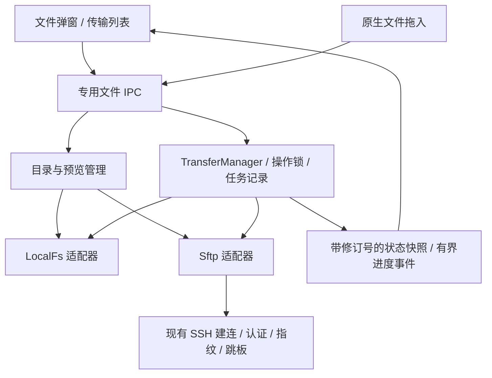

# 文件传输设计方案

状态：开发版已接入 F1–F4 主体能力 · 2026-11-03，未发布；完整平台验收仍在进行。本文保留设计目标，实施结果、差异与验证边界见第 14 节，当前能力以 [项目状态](PROJECT_STATUS.md) 和源码为准。不得为测试连接或修改用户真实 SSH 主机。

2026-11-03 用户调整：文件工作区改为与终端共用的非模态悬浮面板，可停靠底部/左侧/右侧；底部双栏左右、两侧上下。新增 SSH 主机间传输，优先直传、不支持时经本机流式中转，连接图显示真实传输状态。此调整替代下文历史设计中「仅弹窗」「不支持远端到远端」「所有文件任务只请求 SFTP」的限制。

## 1. 目标与范围

在现有 SSH 主机旁提供文件管理与传输入口：非模态悬浮面板的左侧可浏览本机或 SSH 主机，右侧浏览另一 SSH 主机，通过可调整的双栏完成上传、下载、主机间传输、文件管理、预览与文本编辑；传输由 Rust 后台任务管理，收起面板后仍可继续，并可随时查看传输列表。

本轮方案覆盖用户提出的全部能力：

| 需求 | 设计结果 |
| --- | --- |
| 悬浮面板与 resizable 布局 | 与终端共用 WorkspacePanel；底部停靠左右分栏，两侧停靠上下分栏，下方可展开传输区 |
| 本机 / SSH 文件列表 | 两个独立文件面板，目录导航、排序、筛选、多选、隐藏文件 |
| 列表与图标切换 | 每栏独立切换，保留目录、排序和选中项 |
| 两栏拖动上传 / 下载 | 跨栏复制；落在目录上进入该目录，落在空白处使用当前目录 |
| 窗口外拖入右侧 | Explorer / Finder 原生文件与目录拖入，按明确落点上传 |
| 右键菜单 | 传输、预览、重命名、新建目录、删除、复制路径与属性等上下文操作 |
| 文件预览与编辑 | 文本 / 代码、常见栅格图片、SVG / Markdown 预览；显式进入文本编辑，本机和远端采用同一交互 |
| 后台传输与传输列表 | Rust 队列、进度、暂停 / 继续、取消 / 重试、冲突处理、重启后的中断记录 |

本期不包含双向同步、目录对比、远端编辑自动上传、压缩解压、sudo、执行文件、FTP/WebDAV、系统盘挂载、拖出应用到桌面、应用退出后仍运行的系统服务。PDF、Office、音视频、压缩包内容预览作为后续扩展，首期显示属性与下载入口。

## 2. 已核实的基线与架构影响

| 当前事实 | 设计处理 |
| --- | --- |
| Tauri 2 / React 19 / ORIA / shadcn Base UI；窗口最小 760×520 | 复用外壳、主题和弹层基础，在最小窗口仍保留左右两栏 |
| `russh = 0.64.1`，`tunnel.rs` 已有 `connect` / `Connection::open_session` | 复用建连、Agent、凭据、逐跳指纹与 ProxyJump，不另起本机 ssh/scp 进程 |
| 当前没有 SFTP 模块或依赖 | 增加独立 SFTP 适配器，先验证库与现有 russh 的组合再锁版本 |
| 有共享 Dialog、ContextMenu、Progress、ScrollArea、HostPicker、AuthenticationField | 直接组合；文件浏览器保留自己的布局与状态，不复制弹层行为 |
| 当前没有共享 Resizable；终端使用专用 Pointer Capture 手柄 | 从 shadcn Base UI Resizable 补齐通用分栏组件，不改终端已有尺寸行为 |
| `use-native-file-drop.ts` 已处理原生拖入及平台坐标换算；主窗口启用 `dragDropEnabled` | 复用原生事件路径，内部拖动采用 Pointer Events，避免依赖 WebView HTML5 文件拖放兼容性 |
| 当前业务 Modal 为单滚动正文，窄屏会切 Drawer | 文件弹窗直接组合共享 Dialog，让左右列表与传输区独立滚动；不更改普通表单的契约 |
| Rust 管理当前任务，更新安装会检查活动任务 | 文件任务纳入退出、更新安装、主机删除和活动任务门禁 |
| 当前保存配置为 JSON，尚无文件队列存储 | 另设可恢复的传输任务记录，不修改配置导出格式，不引入数据库迁移 |

真实影响包括新增本机文件读写及 SFTP 操作、两项主要依赖、独立后台任务生命周期、敏感路径元数据落盘，以及退出/更新的任务检查扩展。所有文件操作通过专用 Rust IPC；不开放通用 Shell，也不向前端暴露任意文件读写插件权限。

## 3. 入口与悬浮面板布局

### 3.1 入口及连接时机

- 主机卡片、主机列表/详情，在 SSH 终端附近增加「文件传输」图标按钮。点击指定主机入口即明确请求该主机的文件会话，无需先开启转发或终端。
- 顶栏终端附近增加统一入口，显示活动传输数量；托盘增加「文件传输」。统一入口恢复面板，本身不建立新连接。
- 无指定主机时右侧显示 HostPicker 和「连接」；选择主机不自动连接。指定主机入口可尝试已配置的认证，必要时复用现有补充认证及指纹弹窗。
- 右侧为真实 SSH 登录主机，不使用 L/R 的目标地址或 D 的服务地址猜测文件服务器。
- 每次显示一组端点面板，左侧可选此电脑或 SSH，右侧可选另一 SSH；可切换主机，后台列表允许同时存在多台主机任务，不加入多标签文件浏览器。

### 3.2 默认布局

以下仅为结构线框，不是已实现界面或真实连接状态：

```text
┌ 文件传输                                      展开/还原   收起 × ┐
│ 此电脑/SSH · 计数 · 上传/传输    ║ SSH · 连接状态 · 计数 · 下载   │
│ 后退 前进 上级 刷新             ║ 后退 前进 上级 刷新 断开       │
│ C:\Users\…\Downloads            ║ /home/user/projects            │
│ 当前目录筛选   列表/图标  更多   ║ 当前目录筛选   列表/图标 更多  │
│ ─────────────────────────────── ║ ───────────────────────────── │
│ 名称          大小      修改时间║ 名称          大小    修改时间 │
│ [目录] assets                   ║ [目录] models                  │
│ [文件] notes.txt                ║ [文件] config.json             │
│                                 ║                                │
│            独立滚动             ║            独立滚动            │
│                                 ║                                │
├──────────────── 可调整高度 / 展开传输区 ─────────────────────────┤
│ 传输  全部 · 进行中 · 待处理 · 已完成 · 失败     当前主机/全部主机│
│ ↑ archive.zip  主机 / 目标路径    进度 · 速度 · 剩余   暂停 取消  │
│ ↓ output/      主机 / 目标路径    已完成项 / 总项      查看详情   │
└──────────────────────────────────────────────────────────────────┘
```

- 默认靠底部、高 480px；靠左/右默认宽 440px，尺寸受顶栏以下可用空间约束。外框复用终端的边缘尺寸调整、展开/还原与停靠菜单，不改原生窗口尺寸与 Windows 圆角。
- 底部双栏左右排列，两侧双栏上下排列；初始 50:50。左右布局单栏最小 280px，上下布局单栏最小 136px，视口不足时由共享面板约束。分栏与传输区均支持键盘调整。
- 三张卡片、卡片内容与分隔间距统一 8px，标题/路径/搜索控件统一 28px 高度；计数和传输操作与端点选择同一行。
- 下方传输区默认收成 38px 一行摘要；首次提交任务自动展开，可直接拖动高度并收回。低高度下优先保留文件操作，传输区仍可主动展开。
- 在最小窗口中保留相应停靠方向：工具栏收纳到更多菜单、路径省略、列表隐藏次要列；文件区与任务区分别滚动，不让整个面板同时滚动。
- 仅保存布局比例、展开尺寸、两侧视图/排序/隐藏项偏好。当前路径在进程内按主机记忆，首期不另存最近浏览路径或历史访问目录。
- 关闭按钮收起面板，不停止传输；面板无模态遮罩，主界面和原生顶栏仍可操作。认证、预览和确认继续使用各自的模态框。

## 4. 两侧文件面板

### 4.1 导航与视图

两侧各有后退、前进、上级、刷新、路径栏、当前目录名称筛选、隐藏文件开关、排序和视图切换。路径栏平时显示可点击面包屑；点击右侧 TextCursorInput、双击路径或 Ctrl/Cmd+L 进入输入，右侧按钮变为 CornerDownLeft，点击或 Enter 明确跳转。失焦保持编辑，成功恢复面包屑、失败保留草稿，Escape 取消输入。默认本机用户目录，远端为 SFTP 服务端解析的登录目录，不假设一定是 `/home/用户名`。

本机提供「此电脑」/盘符入口及用户目录、下载目录快捷访问；Windows 的 UNC 路径可显式输入，由系统权限处理，不扫描网络、不代填凭据。远端路径按服务端 SFTP 命名空间解释，不把本机盘符和分隔符规则套到远端；chroot 根目录就是该会话可见的根。

| 模式 | 内容与行为 |
| --- | --- |
| 列表 | 名称、大小、类型、修改时间；远端权限可在属性或可选列中显示。默认目录在前、名称升序，可切大小/时间排序 |
| 图标 | 自适应网格，文件夹和类型图标、截断名称及完整名称提示；选择、拖动、右键与列表一致 |
| 空目录 | 明确显示空目录，保留上传/新建文件夹入口 |
| 无筛选结果 | 显示清除筛选，不误判目录为空 |
| 读取中/失败 | 当前目录独立反馈，可取消/重试；失败不清空另一侧或伪造空列表 |
| 连接中/需认证/未连接 | 右侧显示真实状态，禁止上传落点；本机浏览不受影响 |

图标模式首期不自动批量下载远端缩略图，使用统一 Lucide 文件类型图标；图片内容仅在主动预览时读取。默认隐藏系统隐藏项/点文件，用户打开显示后可以操作。目录大小显示「—」，不为展示而递归扫描服务器。

目录按批返回、虚拟化渲染；完成枚举前显示「正在读取」，排序结果可能随新批次变化但选中项按 ID 保持。超过安全阈值时明确提示结果不完整及继续加载，不将已载入结果宣称为完整目录搜索。名称筛选只针对当前已读取目录，不进行递归服务器搜索。

### 4.2 选择与键盘

- 单击选择，Ctrl/Cmd 多选，Shift 连选；Ctrl/Cmd+A 只选当前面板已加载且可见项。跨目录导航清空选区，切视图保留选区；新筛选清理被隐藏的选中项，防止误操作不可见文件。
- 双击/Enter：目录进入，普通文件预览；不能预览的文件显示属性及上传/下载动作，不自动执行或启动外部应用。
- F2 重命名；Delete 打开删除确认；Space 预览单文件；Shift+F10/菜单键打开右键菜单。平台已有快捷键冲突时采用等价菜单入口。
- Ctrl/Cmd+C 在文件面板中复制完整路径；首期不模拟系统文件剪贴板、剪切/粘贴搬运。明确列在菜单中的「复制路径」避免语义混淆。
- 手柄、路径、工具栏、文件视图和传输列表可键盘到达；列表和图标实现对应的 grid 键盘模型、选中状态和焦点恢复。输入框内不触发文件快捷键。

## 5. 拖放与传输提交

### 5.1 拖放规则

| 来源 → 落点 | 结果 |
| --- | --- |
| 本机选中项 → 远端空白 | 上传到右侧当前目录 |
| 本机选中项 → 远端普通目录 | 上传到该目录；高亮并显示完整目标路径 |
| 远端选中项 → 本机空白/普通目录 | 下载到左侧当前目录/落点目录 |
| 系统文件/目录 → 右侧空白/普通目录 | 上传到明确显示的远端目录 |
| 同栏内部、普通文件、符号链接目录、路径编辑区、未连接右侧或窗口其他区域 | 首期不接收；显示不可放置，不猜测落点 |

跨栏始终是复制，源文件保留；Alt/Shift 不切成移动或创建链接。文件夹递归复制，保留目录层级与空目录。拖动未选中项时先选中它；拖动已选中项时携带整组选区，显示数量与方向。滚动到边缘可自动滚动，首期不悬停自动进入目录，避免目标突然变化。

内部拖动使用 Pointer Events + Pointer Capture，达到移动阈值后开始，Escape 取消；拖放遮罩不抢命中测试。外部使用 Tauri 原生事件和已有坐标换算，区分 DPI、缩放及跨屏情况。弹层由最上层单一接收区消费事件，避免主题导入、配置导入和文件传输同时处理一个拖入；确认/认证/预览覆盖时拒绝底层接收。

外部拖入仅接受能取得原生路径的真实文件/目录；邮件附件等虚拟拖放或云盘未落地项若系统不能提供可读路径，明确提示先保存到本机，不将缺失路径当成功。窗口外拖到左侧首期不执行本机复制。

### 5.2 提交时冻结意图

拖放、工具栏上传/下载和右键传输共用一个 Rust 提交流程：

1. 捕获来源条目、本次目标主机及路线身份、目标目录、冲突策略和请求 ID。
2. Rust 验证条目与目录句柄、连接代次、路径和文件类型，创建队列批次；同一请求 ID 重复提交只返回原批次。
3. 队列显示「准备中」，后台枚举目录并检查冲突；普通无冲突文件直接开始，不弹一次普通确认。
4. 目录、主机切换不改变已提交任务；队列明确展示其固定目标。未提交的拖动在主机或目录切换时取消。
5. 只有 Rust 确认任务已接收才反馈已加入列表；完成刷新实际目标目录，不强行跳转当前浏览位置。

右侧未连接时不接受上传。主动连接成功后用户重新提交，不把一次失败拖放偷偷延迟为未来上传。

## 6. 右键菜单与文件操作

复用已有 ContextMenu。对未选中项右键先选中该项，对已选中项右键保留整个选区；空白处菜单不沿用文件选区。不可执行动作有明确禁用原因。

| 场景 | 菜单 |
| --- | --- |
| 本机单文件 | 上传到右侧目录、预览、重命名、复制路径、在资源管理器/Finder 中显示、删除、属性 |
| 远端单文件 | 下载到左侧目录、下载到…、预览、重命名、复制路径、删除、属性 |
| 单目录 | 打开、上传/下载、重命名、复制路径、删除、属性 |
| 多选 | 上传/下载、复制所选路径、删除、属性摘要；单项重命名和预览禁用 |
| 空白区域 | 新建文件夹、刷新、显示隐藏文件、排序、列表/图标切换；远端另有「上传文件…」「上传文件夹…」 |

新建目录与重命名只接受单个名称，不将带路径分隔符的输入解释为跨目录移动。首期不增加批量重命名、远端 chmod/chown 或新建空文件；属性展示大小、类型、修改时间、远端权限与链接目标，未知字段显示未提供。

删除本机文件默认进入系统回收站；平台不支持或失败时保留原项，只有用户另行选择并确认才永久删除。远端删除为永久删除，确认中显示主机、完整父路径、顶层条目和是否含目录；递归删除只遍历确认根内的真实目录，删除链接本身，不跟随目标。删除目录是单独的可取消文件任务，开始后的已删除项不可回滚；失败/取消列出已完成和剩余，不显示整批成功。

正在传输的源/目标及其父目录受应用内部路径锁保护，重命名/删除被阻止并提供定位关联任务；不同无关路径正常操作。用户停止相关任务后可继续操作，不因管理某文件而停止整台主机任务。

## 7. 冲突、文件完整性与特殊路径

### 7.1 冲突交互

默认策略为「遇到冲突询问」，冲突项进入待处理，其他无冲突项继续。2026-11-04 按用户要求改为自动弹窗、多个任务依次提示，关闭保留等待状态并支持从记录重新打开；展示目标主机/路径，跳过、保留两者或替换默认仅作用于当前文件，勾选「所有文件按此操作」后对当前任务后续冲突沿用该选择。Rust 持久保留单项选择、已跳过来源与保留目录映射，重复扫描不重复计数或复制目录。两端类型、大小与修改时间对比及按同类型应用仍为设计目标，不默认为全局永久覆盖。

- 同名目录：可合并目录，逐子项处理冲突，不先删目录。
- 文件与目录类型冲突：仅跳过或保留两者；不递归删掉目录来替换成文件。
- 保留两者：由后端按目标平台分配名称，例如 `report (2).txt`；最终提交仍检查竞争，不能仅凭前端名称预测。
- 替换文件：明确授权单个文件或本批次相同类型，不授权覆盖后来发生变化的另一对象。目标提交前变化时重新进入待处理。
- 同一目标路径的多个任务串行化，父子路径操作也互斥；同时选择父目录和其中子项时去重，避免复制两次。

### 7.2 安全写入与完成判定

每个文件先写目标目录内独占创建的随机临时文件（如 `.oria-transfer-<id>.part`），不直接截断原文件；所有块完成、关闭句柄、检查大小及源变化后，再按目标能力提交最终名称。下载在本机适当执行 flush/sync；上传只有服务端支持且验证后才使用对应同步能力。

优先使用能力已验证的原子重命名/替换。普通 SFTP rename 与扩展能力不同，不把所有服务器当作支持原子覆盖；若不能安全替换，禁用该目标的替换并允许保留两者或跳过，不降级为先删原文件。提交阶段断线且最终结果不明时显示「需核对」，重连后核对临时/最终文件，不能盲目重放覆盖。

SFTP 无通用的比较并交换或远端文件锁保证；提交前复核与应用内锁只能降低外部并发修改风险，不能承诺与其他程序并发改写时绝对无竞争。文件内容经 SSH 完整性保护并进行大小检查；默认不宣称已做端到端哈希比对或远端物理落盘保证。对无法无覆盖发布新名称的平台能力，先验证可用策略，否则明确拒绝，不悄悄允许覆盖。

来源打开时记录元数据，完成前复查文件身份（可获得时）、大小与修改时间；发现变化不发布为成功，让用户重试。远端元数据粒度可能无法识别所有同尺寸修改，文案不把传输当作来源文件的事务快照。

暂停停止派发新块，等待在途请求收敛后关闭当前文件，记录经确认的偏移；「暂停中」与「已暂停」分开。继续时检查源与临时文件；若缺少可信连续性证据，默认重新传输当前文件，保留已完成子项。断线或进程重启后不单凭大小/mtime 续写；首期不承诺跨连接字节级断点续传。后续若加入校验前缀续传，需把额外读取成本与服务器能力单独验证。

取消移除尚未提交的临时文件，保留已完成目标；清理失败在列表中显示残留位置和重试入口。应用只清理由本任务登记并再次验证归属的临时文件，不能按 `.part` 后缀扫描删除用户文件。

### 7.3 名称、链接与元数据

- 本机路径由 Rust 平台 API 处理，远端路径由 SFTP 适配器处理，不用字符串拼接混用两种规则。拒绝服务端返回的路径分隔符、NUL、`.`/`..` 注入与逃逸路径。
- Windows 保留名、尾随点/空格、大小写冲突、Unicode 规范化碰撞、过长名称等进入待处理；用户改目标名或跳过，不静默截断或覆盖。Linux 等大小写敏感目录中的 `A`/`a` 下载到不敏感目标时必须产生可见冲突。
- 非 UTF-8 名称或本机非标准字符串路径若所选库不能无损往返，显示转义名称并禁用破坏性操作/传输，解释限制；禁止以替换字符形成另一个可写路径。
- 显示符号链接及其目标。用户主动打开链接目录可以导航，但批量递归传输默认跳过链接并列出原因，删除只删链接；Windows junction/reparse point 同样处理，防止递归环和跨根读取。
- 仅传输普通文件和目录；FIFO、设备、socket 等特殊项跳过并列出，不尝试读取阻塞设备。
- 临时文件及预览缓存采用当前用户限制权限；新增文件遵循目标默认权限，替换尽量保留原权限，可支持修改时间保留。首期不复制所有者、ACL、扩展属性、稀疏布局或硬链接关系，也不自动继承源端可执行位；元数据设置失败显示「完成，有警告」。
- 本机写入/删除用句柄相关与不跟随链接的检查；远端每步复核目标父目录/链接。SFTP 服务端仍拥有最终路径解析权，不宣称能沙箱化一个恶意服务器。

## 8. 文件预览

单文件 Space、双击或菜单打开弹窗上层的只读预览，关闭回到原面板焦点与选区；预览不改变后台传输。显示名称、来源侧/主机、路径、类型和大小，以及上传/下载动作。

| 类型 | 首期行为与建议限制 |
| --- | --- |
| 文本、代码、配置、日志 | 默认读取前 1 MiB，可主动追加至 5 MiB；显示编码、行号与截断标记，长行限宽/可换行，渲染文本不执行 |
| PNG/JPEG/WebP/GIF 等栅格图片 | 文件上限 20 MiB、解码像素建议上限 40MP；适应窗口/原始尺寸/缩放，动图默认静止首帧 |
| HTML/SVG/Markdown | HTML 源码；SVG 严格校验后在图片上下文显示；Markdown 受限渲染，支持源码切换，外部图片仅 HTTP(S)，不执行脚本 |
| PDF、Office、音视频、压缩包、未知二进制 | 属性与明确的暂不支持说明，提供下载；不自动交给系统执行 |

文本优先 UTF-8及 BOM 标识的 UTF-16；无法识别时给编码提示，不用乱码覆盖源文件。2026-11-04 按用户要求加入不超过 5 MiB 的完整文本编辑、编码/换行保持、内容版本检查及同目录临时文件原子保存；草稿只在内存保留，关闭未保存文件须确认。安全替换不受支持时拒绝保存，不先删原文件；不执行文本或源码。

远端预览通过独立的受限读取请求取得范围内容，不把整个大文件读入 IPC JSON；先检查实际类型/大小，再使用有上限的字节通道，图片以受控 Blob 呈现并及时撤销 URL。限制解码尺寸应在完整解码前校验文件头，并有超时/内存兜底；不能先任意解码再检查。

预览请求低于用户目录导航和正常传输优先级，切换文件/关闭即取消；不自动预取所有文件。默认使用内存有界缓存；确需临时文件时放应用私有目录，关闭释放、启动清理已登记缓存；内容、缩略图、密码和私钥正文不写日志、配置或任务历史。用户显式预览的秘密文件内容仅短暂存在预览内存，不为预览而保存凭据。

## 9. 传输列表与后台生命周期

### 9.1 传输列表

文件夹或一次多选作为一个批次，可展开看每个子项。摘要显示上传/下载方向、来源与目标、主机、总项/完成项、确认字节、速率、剩余时间、状态及操作。总大小尚未枚举完显示「正在统计」，无可靠速率/剩余时间显示「—」，不补造百分比。

默认全局并发 4 个文件、每主机 2 个，公平调度并保留浏览请求容量；这是待性能验证的初始值，不承诺网络速度。失败/待冲突项不占传输槽。列表提供状态和主机筛选、批次/单项暂停继续取消、失败重试、查看目标、清除终态记录；批量动作明确作用于所选或筛选范围。

Rust 以有界频率合并进度（建议最高 4 次/秒），终态和需用户处理事件立即发送；前端按任务 revision 合并并虚拟化列表。速率、字节、ETA 均由 Rust 实际读写计算。100% 字节后仍可能显示「正在提交」，只有关闭与最终名称确认完成才为成功。

建议状态：排队、准备中、连接中、需认证/指纹确认、传输中、暂停中、已暂停、等待重试、待处理（冲突/来源变化/结果待核对）、提交中、完成、完成有警告、部分完成、失败、取消中、已取消、中断。目录批次中有跳过/失败不得显示成无条件全部成功；UI 显示具体计数。

### 9.2 收起、重载、退出

| 动作 | 行为 |
| --- | --- |
| 收起文件弹窗、切换应用页面 | 队列继续，根部入口保留活动数量；浏览面板可卸载，任务不绑定组件 |
| 切换右侧主机 | 切换浏览上下文，原主机任务保留其来源、目标与路线 |
| WebView 重载 | Rust 任务继续；新前端先订阅再读取快照；失效的旧预览/目录句柄回收 |
| 最小化/已有策略下隐藏到托盘 | 进程仍运行则继续传输；不改变用户原有窗口关闭偏好 |
| 断开浏览连接 | 释放浏览会话；有后台任务时它们按独立引用继续。菜单另设明确的「停止此主机传输」 |
| 明确退出/安装更新 | 汇总活动文件操作，允许取消退出/保持后台，或确认停止后退出；停止接单、收敛任务、持久记录后再退出 |
| 崩溃、系统关机、下次启动 | 未终结任务显示中断，不自动连接、不自动覆盖；用户选择重试，重新验证来源与目标 |

任务元数据单独原子保存为应用私有 `transfers.json`（名称为建议）：任务身份、方向、主机与路线身份摘要、路径、冲突选择、临时文件归属、状态与已完成项。保留必要路径是为恢复和查找目标，文件内容及凭据绝不落入记录；限制为当前用户可读，不加入分享/配置导出或普通诊断日志。

完成历史建议保留最近 7 天且最多 1000 条批次，提供清除；活动/待处理任务不自动淘汰。目录清单较大时用独立的可流式恢复任务文件，限制内存，不把百万条目反复写成单个大 JSON。记录损坏时保留原文件并提示，不能推断任务完成，也不自动清理远端文件。

自动重试仅用于有明确幂等证据的读取、未开始任务或当前独占临时文件上的可恢复操作，建议退避 1/3/10 秒后待处理。认证失败、指纹变化、权限拒绝、空间不足、目标冲突不自动重试；删除、重命名及结果不明的提交不盲目重放。睡眠/断网后遵守同一规则，不重新发起未经确认的覆盖。

## 10. Rust 架构与 IPC 边界



### 10.1 会话与身份

文件功能使用独立 SSH 连接，不借用转发或终端的活动连接。复用的是连接代码、认证和信任策略；暂停文件任务不停止转发，关闭终端也不结束文件任务。

同一文件工作上下文内，浏览与传输可以共享独立文件连接上的多个 SFTP channel，但各自取消 channel，不能随意取消父连接；空闲无引用后释放。以主机 ID、完整跳板路线身份、配置修订和连接代次隔离，禁止仅按显示名合并会话，也不建立跨功能全局连接池。每台主机的连接/通道数量有界，服务器拒绝额外 channel 时降低并发或明确报错。

开始时冻结已解析配置及路线。运行中主机编辑不改变已有传输目标；新连接或重试若路线/用户名/端点变化，进入待处理让用户明确重新提交。主机及跳板删除检查活动文件引用，先要求处理关联文件任务；不在删除主机的确认里隐式删除远端文件。

本机上传/下载、浏览和文件操作仅请求 `sftp` subsystem，不发送 Shell、PTY、RemoteCommand 或服务命令；服务端不支持 SFTP 时明确报错。按用户后续明确要求，主机间传输可打开独立 exec channel 执行固定 OpenSSH 命令，先探测源推送/目标拉取，再决定是否通过已验证的 SFTP 会话中转；不将文件操作降级为 Shell ls/cat/rm。保留现有不支持连接配置的诊断，不能为文件功能绕过 ProxyCommand 等限制。

### 10.2 模块与数据

建议在 `src-tauri/src/files/` 内分离 `local`、`sftp`、`listing`、`preview`、`transfer`、`journal` 和路径/冲突处理；`app_files.rs` 承担 IPC 输入验证及现有 AppState 的接入。前端领域放 `src/features/files/`；共享新增能力只包括 `ui/resizable.tsx`，页面私有组件不挤入通用组件库。

核心对象：

| 对象 | 职责 |
| --- | --- |
| FileSession | 主机/路线/连接代次、认证状态与能力，不含可回传秘密 |
| DirectorySnapshot / EntryRef | 所属端、会话代次、目录修订、条目 ID、显示名称、类型、元数据与分页游标 |
| TransferBatch / TransferItem | 固定源目标、父批次、状态、冲突策略、确认字节、错误类别、修订 |
| MutationPlan | 绑定对象及版本的重命名/删除确认计划，提交时复核 |
| PreviewHandle | 受限来源、读取预算、生命周期与取消令牌 |

IPC 按语义划分为打开/关闭文件上下文、读取目录、提交传输、任务控制、预览读取、准备/提交删除或重命名、获取快照。具体命名实施时确定；以 requestId 保证重复点击幂等，以 epoch/revision 拒绝旧会话事件和目录响应。切路径后迟到的目录页不能覆盖新目录。

前端传条目引用与目的目录引用，Rust 重新解析真实路径与权限；前端自行构造的字符串不构成删除/覆盖授权。手动地址与原生拖入路径作为明确导航/来源输入，由 Rust 校验后生成上下文。原生拖入的路径登记在本次窗口请求下，避免伪造跨窗口/过期拖放。

取消、暂停、删除、更新退出共用任务生命周期门禁。文件内容不走全局状态快照，大文件按有界块读取并背压；文件列表条目与进度也设置数量和字节上限。已有转发流量统计不混入文件传输，文件进度事件不驱动全画布重渲染。

现有 `AppState::stop_all_checked` 同时承担退出清理等职责，接入时必须区分「停止已有转发/服务工作」与「应用退出的全任务清理」调用路径，不能简单把文件队列取消塞入所有停止入口。文件传输由自己的停止动作控制；应用退出/安装更新才统一收敛所有类型的任务。

## 11. 组件与依赖选择

| 能力 | 选择与理由 |
| --- | --- |
| 分栏 | shadcn Base UI Resizable，底层为 `react-resizable-panels`；补充真正缺失的布局能力，与现有组件风格一致 |
| 弹层 / 菜单 / 选择器 / 进度 | 复用项目现有 Base UI 组合，不增加第二套弹层或文件管理 UI 套件 |
| 内部拖动 | Pointer Events，复用项目 Pointer Capture 经验；首期不增加全局 DnD 状态库 |
| 外部拖入 | 现有 Tauri `onDragDropEvent` 与命中换算；必要时集中为单一接收路由并回归现有导入 |
| SFTP | 候选 `russh-sftp`；接收异步流，可与现有 channel 适配，需实测兼容与低层能力后锁定 |
| 大目录 / 任务列表 | 优先扩展已有活动列表虚拟化方法，图标按固定高度网格行虚拟化；出现无法解决的可访问性/性能问题再评估新依赖 |
| 图片 / 文本 | 有界原生读取和受限渲染，首期不新增 PDF/Office/完整编辑器依赖 |

官方资料确认 shadcn 的 Resizable 封装基于 `react-resizable-panels`，当前包装 API 与底层升级存在差异，实施时按实际锁定版本接入，而非复制旧版示例。[Resizable 官方文档](https://ui.shadcn.com/docs/components/base/resizable)

`russh-sftp` 提供基于异步读写流的会话、目录与文件 API；它适合作为候选，但文档并不替代本项目 russh 0.64.1 的编译/集成验证。需检查扩展能力、独占创建、取消、分批目录读取和字符串路径限制；高层 API 不满足边界时优先用库的低层协议接口，不自写协议。[SftpSession 官方 API](https://docs.rs/russh-sftp/latest/russh_sftp/client/struct.SftpSession.html)

外部拖入沿用官方 WebView 原生事件接口。[Tauri WebView API](https://v2.tauri.app/reference/javascript/api/namespacewebview/)

新增依赖在第一阶段核对 React/Rust 支持、许可证与打包声明、锁文件和四个发布目标；未验证前不宣称特定版本已经兼容。当前仓库未发现根目录 `components.json`，不直接运行会覆盖现有组件的初始化；按项目已有封装手工集成所需组件。

## 12. 实施阶段与验收

所有阶段都属于本次完整功能范围的拆分；F1 的可运行闭环不等于整项功能完成。仅使用应用独立数据目录、临时文件和自建回环 SSH/SFTP 测试服务；不为测试连接用户真实 SSH。

| 阶段 | 交付 | 必须提供的证据 |
| --- | --- | --- |
| F1：协议与最小闭环 | 独立 SFTP 会话、双栏列表、单文件上传/下载、后台任务、临时文件提交 | 实际往返文件字节一致；认证/指纹/跳板/SFTP 拒绝；关闭弹窗继续，转发与终端不受影响；依赖版本锁定 |
| F2：完整浏览与操作 | Resizable、图标视图、多选、两种拖放、右键、递归目录、冲突、重命名/删除 | Windows/macOS 原生拖入及 DPI；空目录与混合冲突；不跟随链接；删除确认与部分失败；760×520、深浅主题与键盘 |
| F3：预览与任务恢复 | 文本/图片预览、暂停继续、重试、任务历史、崩溃/重载恢复 | 大文件不整包进入前端；恶意预览不执行；内存上限；断线结果不明不误报；重启不自动连接/覆盖 |
| F4：集成收口 | 托盘/顶栏入口、更新/退出门禁、主删除引用保护、八语言、文档与性能 | 退出和更新无遗留写任务；旧功能回归；大目录/批量队列响应；平台差异有设备证据 |

重点测试矩阵：

- 文件语义：零字节、超过 4 GiB、中文/空格/emoji、深目录、空目录、同名/大小写碰撞、不可表示名称、源在传输中改变、目标外部改变、读写权限拒绝、本机/远端空间不足。
- 操作安全：临时文件独占创建、无覆盖提交、支持/不支持原子替换、覆盖确认后目标改变、链接环/junction/父目录替换、路径注入、递归删除中断、取消清理失败。
- 网络与恢复：连接/读取/写入/关闭/rename 各阶段断线，延迟和超时，认证取消、指纹变化、ProxyJump 中间跳失败，暂停/继续与迟到事件竞争，进程崩溃和损坏任务记录。
- UI：列表/图标保留选区、跨栏多选拖动、系统目录拖入、最上层弹窗接收隔离、手柄拖动与文件拖动不冲突、错误定位、焦点恢复、减少动态效果、长名称和八语言布局。
- 性能：至少 10,000 项目录与大量小文件、并行大文件时浏览/取消仍响应；限制 DOM、目录快照、进度事件、预览解码和队列内存，记录实际峰值与设备环境，不预填虚假性能承诺。

运行相应前端组件/状态测试、TypeScript/构建、Rust 单元与回环集成测试、Clippy/格式及文档检查。Windows 和 macOS 的文件系统、回收站、拖放、大小写与权限必须分别验证；单个平台结果不代表另一平台通过。

## 13. 备选方案、风险与回退

| 备选或风险 | 决策与处理 |
| --- | --- |
| 在本机调用系统 scp/sftp | 不采用；远端主机间直传按用户新增要求使用远端工具，绑定已验证的身份和固定命令，失败/不确定结果不盲目重放 |
| 在终端连接上附加文件通道 | 不采用：生命周期和取消耦合，容易因关闭终端影响后台传输 |
| 系统独立文件窗口 | 不采用；使用应用内非模态共享悬浮工作面板 |
| 自写完整分栏控件 | 优先已有 shadcn 路线；若版本兼容受阻再用现有手柄逻辑，不同时维护两套公共组件 |
| 服务端能力差异 | 每会话记录能力；不支持安全覆盖/特殊文件名时明确降级可用动作，不能偷偷改用 Shell |
| 路径元数据隐私 | 私有文件、最短必要保留、用户清除、不进入配置分享；不声称路径不敏感 |
| 拖放/预览资源消耗 | 独立验证原生拖放路径，限制缓存、枚举、图片像素和传输缓冲；失败给可恢复结果 |

实现回退可撤除入口、IPC 注册和新模块，保留现有转发/终端接口与配置格式；先停止文件任务再撤除。已完成的本机/远端文件操作不可随代码回退自动撤销。任务记录和未清理临时文件只按其归属提供清理，不借回退删除用户目标文件。

## 14. 开发版实施结果与验证边界

| 阶段 | 当前实现与证据 | 尚未形成的验收证据 |
| --- | --- | --- |
| F1 | 独立 SFTP 连接和浏览、实际文件往返、临时文件独占写入及安全提交；锁定 russh-sftp 3.0.1 / react-resizable-panels 4.12.0；认证和跳板复用已验证的连接引擎 | 不同 SSH 服务端的设备兼容矩阵 |
| F2 | 双栏和队列 Resizable、Breadcrumb、实际磁盘、多选、列表/图标、内部及原生拖入、菜单、递归目录、冲突和文件操作；回环验证中文路径、空目录、冲突、取消及删除；独立 Windows 窗口验证两侧更多菜单与排序 | macOS 原生拖放/回收站/权限，不同 DPI、大小写和链接竞态的完整矩阵 |
| F3 | 有界二进制预览、真实字节进度、暂停/继续/取消、历史、中断恢复、损坏记录保护、结果不明内容核对；有界超时重试只用于可安全重放的读写块 | 各协议阶段断线、磁盘耗尽、超过 4 GiB 与长期内存压力的完整矩阵 |
| F4 | 顶栏/主机/托盘入口，更新与退出清理，主机及跳板引用保护，八语言资源与使用说明；153 项 Rust 库测试、247 项前端全量通过，类型/构建/严格 Clippy 通过；既有 33 项回环集成通过 | 完整跨平台原生验收；尚未发布 |

主机间传输按批次优先探测源端推送、再探测目标端拉取；当前直传要求执行端具备 OpenSSH 9+、固定公钥输出工具和可用默认免密身份。只发送已验证的主机公钥，不发送本机私钥/口令或启用 Agent；命令禁止读取远端 SSH 配置，并保留对端已配置的加密算法策略。载荷直接在主机间复制到专属临时文件，进度读取实际目标大小；最终提交仍经 SFTP 核对元数据并安全重命名。直传已提交后不自动换方式重放，结果不明时保留进程 ID 与临时文件，显式核对并确认停止后才允许继续/清理。未确认停止的任务保护两端主机及跳板，并阻止安装更新。

连接图对直传显示主机间单段、中转显示经此电脑的两段；上传/下载仍为本机与主机之间。仅实际 transferring 状态播放连线和文件图标动画，减少动态效果时静止，已完成任务移除临时连线。两端进度事件不改变无关 TCP 转发状态。

源码入口为 `src-tauri/src/files/{mod,fs,direct,tests,direct_tests}.rs`、`src-tauri/src/app_files.rs` 与 `src/features/files/`。继续使用已存在的信任/认证/退出流程，不在本机启动生产 scp/sftp 进程，不修改用户真实主机配置或应用版本；直传时由远端 OpenSSH 客户端执行复制。

当前实现采用明确上限的整目录快照（最多 20,000 项），前端按列表/图标行窗口化；递归提交最多 50,000 项。任务以提交批次控制，记录可按 200 条渐进加载；默认按传输类型分组且最新在前，可独立调整时间方向和源/目的主机分组。多选批次由文件图标展开所选根条目，明细窗口化并在收起后卸载，逐项状态以 Rust 已确认的来源路径为依据。不是磁盘分页浏览或逐文件独立队列，超限明确报错。复制保留文件内容与目录结构，不承诺保留源时间戳、所有者和完整权限；临时文件采用受限权限。

继续传输会跳过已经完成的文件，当前文件从头复制；应用启动不自动连接或自动覆盖。预览关闭后丢弃迟到响应并释放 Blob；原生最多两个预览/编辑读取，尚未提供逐请求立即取消解码。只读代码采用按需高亮与虚拟列表，编辑通过共享多行输入进行，完整文本上限 5 MiB；栅格图片为尺寸约束内的静态预览。这些边界在实现与使用说明中保留，不把设计中的扩展细节当作已验证功能。

Windows 原生菜单回归使用独立数据与 SSH 来源；未连接用户真实 SSH。10,000 项本机目录本轮约 0.75 秒，为一次自动测试读枚举结果，不代表多平台性能或界面帧率。全部设备、故障和内存矩阵通过前，不将本方案标为完整验收。
