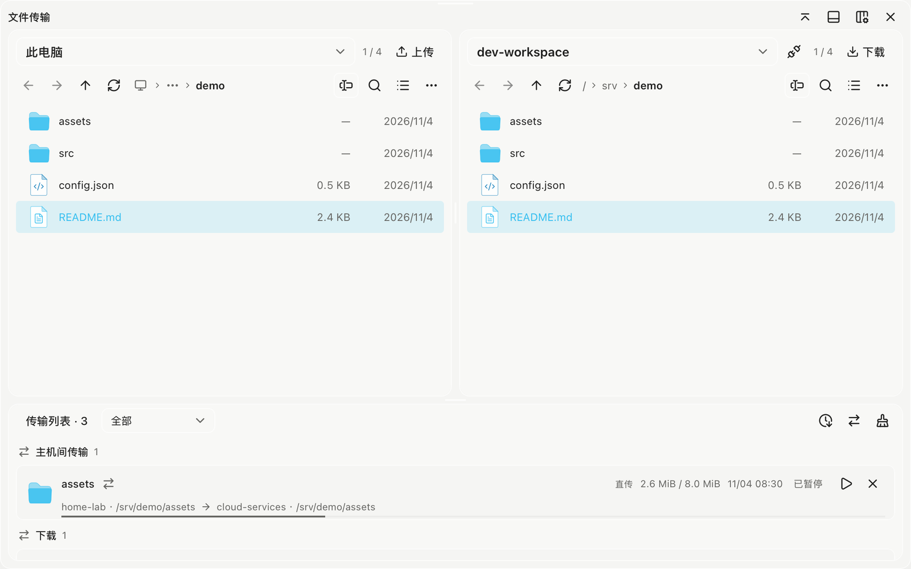
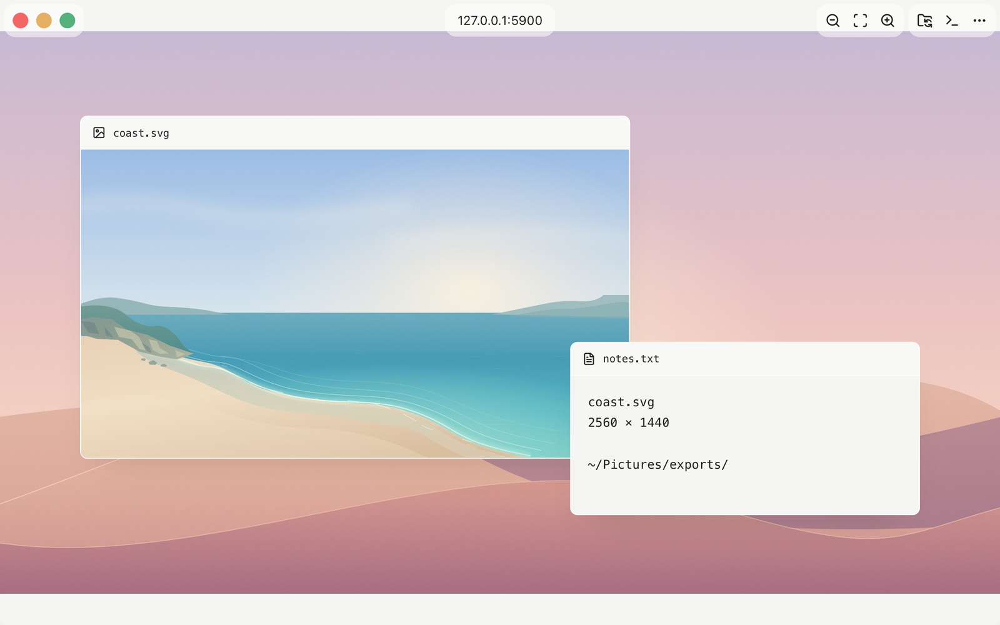
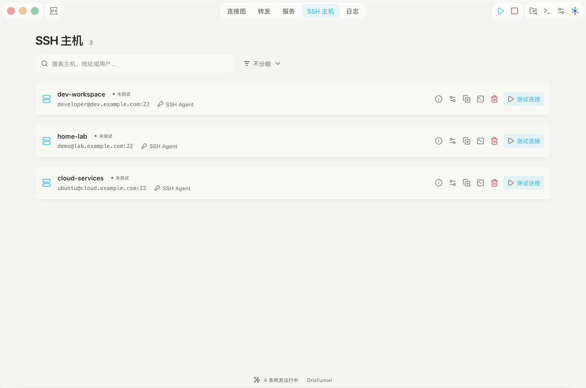

  <picture>
    <source media="(prefers-color-scheme: dark)" srcset="../assets/oriatunnel-logo-dark.svg">
    
  </picture>

<h1 align="center">One SSH workspace for remote management</h1>

Manage SSH tunnels, remote services, terminals, file transfers and remote desktops together in OriaTunnel.

  <a href="../../README.md">简体中文</a> · <a href="README.zh-TW.md">繁體中文</a> · English · <a href="README.ja.md">日本語</a> · <a href="README.ko.md">한국어</a> · <a href="README.de.md">Deutsch</a> · <a href="README.fr.md">Français</a> · <a href="README.ru.md">Русский</a>

**[Download and install](#download-and-install)** · [Quick start](#quick-start) · [Full user guide (Simplified Chinese)](../USAGE.md) · [Live demo (Chinese)](https://oriamade.com/zh-CN/oria-tunnel#workspace)

## What you can do

### 🔗 Visual tunnel management

- See how local ports connect to SSH hosts on the connection map. Start or stop rules individually or in batches and track their status, active connections and traffic.
- Pick a host from your SSH configuration or add one manually. Connect with a password, private key or system SSH agent, including across multiple ProxyJump hosts.
- Save a rule to reopen an internal web app from the map or connect your database client to its local port.

### ⚙️ Remote services

- Save start, stop, restart, status and log commands in a template. Link it to a forward to run those actions from the service menu.
- If a service needs to start first, configure its startup command and health check. Follow each step as the command runs, the check completes and the tunnel connects.

### 💻 Local and SSH terminals

- Switch between local and remote sessions in tabs. Use suggestions as you type, press ↑ for history or recall a saved command by keyword across sessions.
- Edit multiple lines with Shift+Enter and keep your draft when changing directories. Collapse long output and copy a command or its result separately.

### 📁 File transfers

- Browse directories side by side. Drag files between panels for batch uploads and downloads, or open a different SSH host in each panel to transfer between them.
- Track each batch in the background queue and pause, resume or cancel tasks. Preview files and edit text directly in the workspace.

### 🖥️ VNC remote desktop

- Open a VNC forward in its own window over SSH. Switch to full screen, adjust zoom and copy text in either direction.
- Open an SSH terminal or transfer files over SFTP in the desktop window. Submitted transfers continue after you close it.

## Download and install

| Platform | Installer v0.4.0 | Installation |
| --- | --- | --- |
| macOS | [Apple Silicon](https://github.com/KrisLee1/OriaTunnel/releases/download/v0.4.0/OriaTunnel_0.4.0_aarch64.dmg) · [Intel](https://github.com/KrisLee1/OriaTunnel/releases/download/v0.4.0/OriaTunnel_0.4.0_x64.dmg) | Open the disk image and drag OriaTunnel into Applications. |
| Windows | [x64](https://github.com/KrisLee1/OriaTunnel/releases/download/v0.4.0/OriaTunnel_0.4.0_x64-setup.exe) · [ARM64](https://github.com/KrisLee1/OriaTunnel/releases/download/v0.4.0/OriaTunnel_0.4.0_arm64-setup.exe) | Run the installer and follow the prompts. |

### Version history

**v0.4.0** · Local and SSH terminals now support completion, a shared command library, multiline editing and collapsible output. Check for updates under **About**.

[Release notes (Chinese)](../releases/v0.4.0.md) · [All releases](https://github.com/KrisLee1/OriaTunnel/releases)

## Quick start

This example connects your browser to a web service already running on port 3000 of the SSH server.

1. Open OriaTunnel and choose **Add host**. Select a host discovered from SSH configuration, or enter its details manually. Discovery only reads configuration; it does not connect automatically.
2. Choose **New forward**, select the host and choose local forwarding (L). Set the listener to `127.0.0.1:13000` and the target to `127.0.0.1:3000` on the SSH server.
3. Choose **Save and start**, authenticate when prompted, and verify the server fingerprint on the first connection. Once the rule shows **Listening**, open `http://127.0.0.1:13000` in your local browser.

Next time, start the saved rule. If the page fails to load, check that the remote service is running on the target port. [troubleshooting guide (Chinese)](../USAGE.md#查看状态与排查问题)

### Choose a forwarding mode

| Mode | When to use it | How you access the service |
| --- | --- | --- |
| **L · Local forwarding** | Access a server's web app, database, or VNC service from this computer | Connect to a local listening port, which reaches the remote service over SSH |
| **R · Remote forwarding** | Let a server access a development service running on this computer | Connect to a listening port on the server, which reaches the local service over SSH |
| **D · Dynamic forwarding** | Reach multiple internal addresses through an SSH host | Open an isolated proxy browser from the menu, or configure another client to use local SOCKS5 |

Already have an OriaTunnel configuration file? Choose **Import configuration** on the forward page, review it, and supply your authentication details before starting. Imported service templates require review and explicit enablement. See [use an existing configuration (Chinese)](../USAGE.md#使用现成配置).

## Screenshots

These light and dark interface previews use sample data from the OriaTunnel demo in OriaMadeWeb.

| <picture><source media="(prefers-color-scheme: dark)" srcset="../assets/screenshots/connection-map-dark.png"></picture> | <picture><source media="(prefers-color-scheme: dark)" srcset="../assets/screenshots/terminal-dark.png"></picture> |
| :---: | :---: |
| <picture><source media="(prefers-color-scheme: dark)" srcset="../assets/screenshots/files-dark.png"></picture> | <picture><source media="(prefers-color-scheme: dark)" srcset="../assets/screenshots/vnc-dark.png"></picture> |

More screenshots

| <picture><source media="(prefers-color-scheme: dark)" srcset="../assets/screenshots/forwards-dark.png"></picture> | <picture><source media="(prefers-color-scheme: dark)" srcset="../assets/screenshots/services-dark.png"></picture> |
| :---: | :---: |
| <picture><source media="(prefers-color-scheme: dark)" srcset="../assets/screenshots/hosts-dark.png"></picture> | <picture><source media="(prefers-color-scheme: dark)" srcset="../assets/screenshots/logs-dark.png"></picture> |

## Documentation and support

[Full user guide (Simplified Chinese)](../USAGE.md) · [troubleshooting guide (Chinese)](../USAGE.md#查看状态与排查问题) · [development guide (Simplified Chinese)](../DEVELOPMENT.md) · [GitHub Issues](https://github.com/KrisLee1/OriaTunnel/issues)

## License

Copyright (C) 2026 KrisLee.

OriaTunnel is licensed under the **GNU General Public License, version 3 only (GPL-3.0-only)**. See [LICENSE](../../LICENSE) for the full terms.

This software is provided without any warranty, as detailed in the license. Third-party code, dependencies, and assets retain their respective licenses and notices. Bundled third-party license texts are available in [docs/licenses](../licenses).
