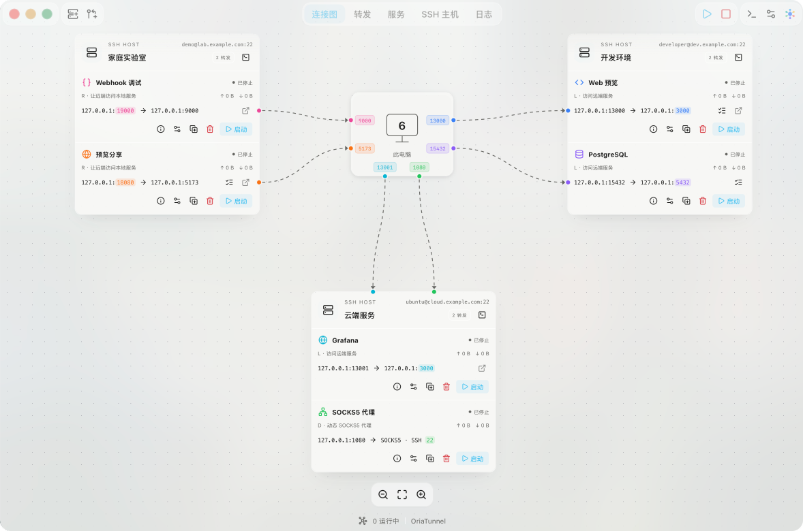
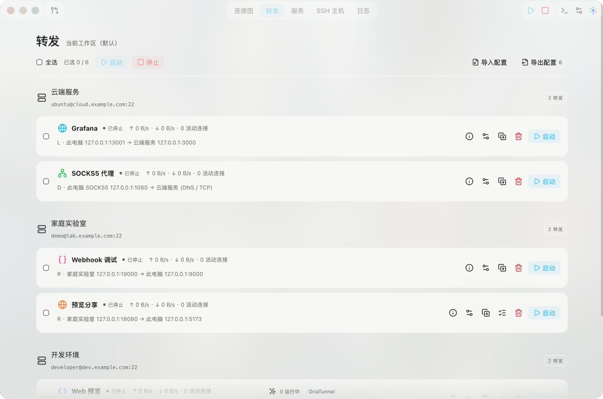
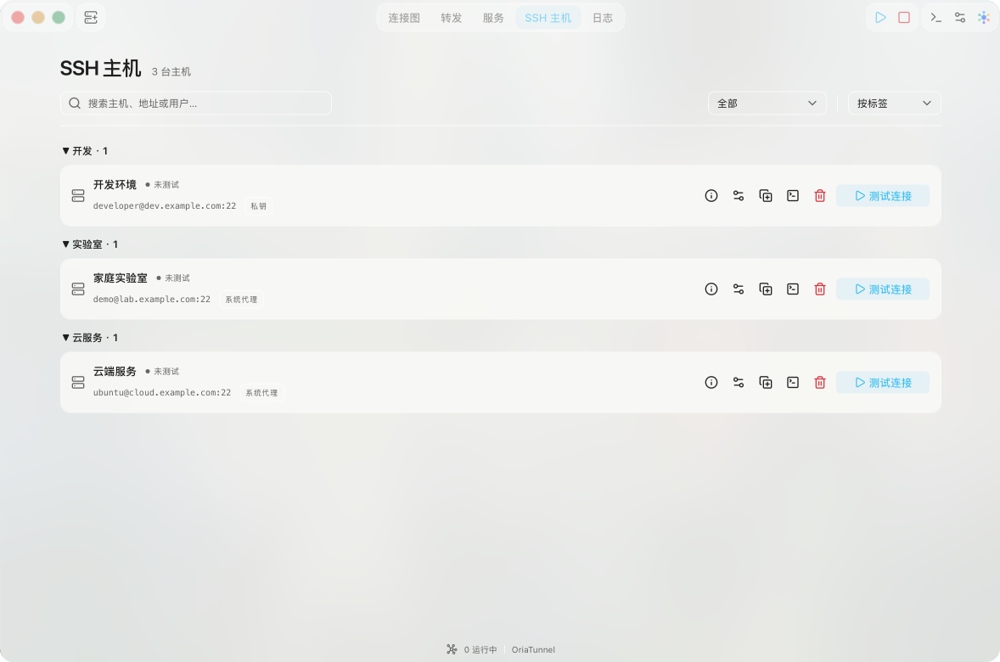
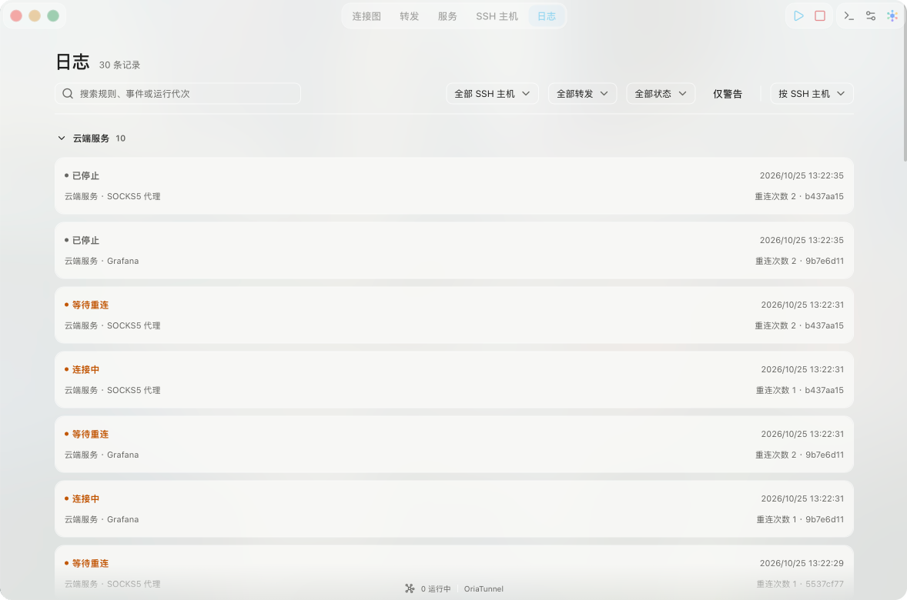

  <picture>
    <source media="(prefers-color-scheme: dark)" srcset="../assets/oriatunnel-logo-dark.svg">
    
  </picture>

Gérez vos tunnels SSH sur une carte des connexions et gardez vos services distants à portée de main.

  <a href="../../README.md">简体中文</a> · <a href="README.zh-TW.md">繁體中文</a> · <a href="README.en.md">English</a> · <a href="README.ja.md">日本語</a> · <a href="README.ko.md">한국어</a> · <a href="README.de.md">Deutsch</a> · Français · <a href="README.ru.md">Русский</a>

OriaTunnel est une application de bureau de redirection de ports SSH pour Windows et macOS. Retrouvez vos hôtes SSH, les chemins de redirection et leur état en direct sur une carte des connexions ou dans une liste. Enregistrez des connexions réutilisables pour vos bases de données, tableaux de bord web, services de développement et bureaux distants.

**[Guide utilisateur complet (chinois simplifié)](../USAGE.md)** · [Prise en main](#prise-en-main) · [Choisir un mode de redirection](#choisir-un-mode-de-redirection)

## Captures d’écran

Captures natives de la version de développement actuelle, adaptées au mode clair ou sombre du système. Configuration de démonstration isolée : 3 hôtes et 6 redirections L / R / D, toutes arrêtées. Aucun serveur réel ni identifiant de connexion.

| <picture><source media="(prefers-color-scheme: dark)" srcset="../assets/screenshots/connection-map-dark.png"></picture> | <picture><source media="(prefers-color-scheme: dark)" srcset="../assets/screenshots/forwards-dark.png"></picture> |
| :---: | :---: |
| <picture><source media="(prefers-color-scheme: dark)" srcset="../assets/screenshots/hosts-dark.png"></picture> | <picture><source media="(prefers-color-scheme: dark)" srcset="../assets/screenshots/logs-dark.png"></picture> |

## Fonctionnalités

- **Gérer plusieurs tunnels :** affichez les connexions par hôte et démarrez ou arrêtez les règles individuellement ou par lot.
- **Utiliser les modes de redirection SSH habituels :** redirection locale (L), redirection distante (R) et redirection SOCKS5 dynamique (D), avec prise en charge de routes ProxyJump ordonnées à plusieurs relais.
- **Réutiliser les réglages des hôtes :** détectez les hôtes disponibles dans la configuration SSH ou ajoutez-les manuellement ; authentifiez-vous avec un mot de passe, une clé privée ou l’agent SSH du système.
- **Suivre le fonctionnement :** consultez l’état des connexions, les adresses et ports d’écoute, le trafic, les connexions actives, la progression des reconnexions et les journaux d’événements filtrables.
- **Garder les tunnels disponibles :** fonctionnement dans la zone de notification ou la barre des menus, reconnexion après une panne réseau et, en option, lancement à l’ouverture de session ou connexion des règles choisies au démarrage de l’application.
- **Organiser et transférer les configurations :** personnalisez les noms, étiquettes, couleurs et icônes ; importez ou exportez les règles de connexion.
- **Choisir parmi huit langues d’interface :** chinois simplifié, chinois traditionnel, japonais, coréen, anglais, allemand, français et russe, y compris pour les messages d’erreur natifs et les diagnostics de configuration SSH. Des réglages d’apparence claire, sombre et de thème sont disponibles.

## Choisir un mode de redirection

| Mode | Cas d’utilisation | Accès au service |
| --- | --- | --- |
| **L · Redirection locale** | Accéder depuis cet ordinateur à une application web, une base de données ou un service VNC du serveur | Se connecter à un port d’écoute local qui mène au service distant via SSH |
| **R · Redirection distante** | Permettre à un serveur d’accéder à un service de développement exécuté sur cet ordinateur | Se connecter à un port d’écoute sur le serveur qui mène au service local via SSH |
| **D · Redirection dynamique** | Atteindre plusieurs adresses internes via un hôte SSH | Configurer le navigateur ou un autre client pour utiliser un proxy SOCKS5 local |

Un serveur avec une adresse IP partagée et un seul port SSH attribué peut tout de même donner accès à plusieurs services via ce port. Consultez l’[exemple d’adresse IP partagée (chinois)](../USAGE.md#场景四共享-ip只分配一个-ssh-端口).

## Prise en main

Préparez l’adresse SSH, le port, le nom d’utilisateur et la méthode d’authentification. Le service auquel vous souhaitez accéder doit déjà fonctionner.

1. Ouvrez OriaTunnel et choisissez **Ajouter un hôte**. Sélectionnez un hôte détecté dans la configuration SSH ou saisissez ses informations manuellement. La détection lit uniquement la configuration ; elle ne se connecte pas automatiquement.
2. Choisissez **Nouvelle redirection**, sélectionnez l’hôte et L / R / D, puis renseignez l’adresse et le port d’écoute. L / R nécessitent aussi une adresse et un port cibles.
3. Choisissez **Enregistrer et démarrer**, authentifiez-vous lorsque l’application le demande et vérifiez l’empreinte du serveur lors de la première connexion.
4. Attendez l’état **En écoute**, puis utilisez le point d’accès de la redirection dans votre navigateur ou votre client. Pour D, configurez d’abord le client pour utiliser SOCKS5.

Par exemple, pour accéder à une application web sur votre serveur SSH, choisissez **L**, écoutez sur `127.0.0.1:13000` et définissez `127.0.0.1:3000` comme cible. Une fois la redirection démarrée, ouvrez `http://127.0.0.1:13000` sur cet ordinateur. L’adresse cible `127.0.0.1` désigne **le serveur SSH lui-même** ; cet exemple suppose que l’application web y fonctionne sur le port 3000.

L’état **En écoute** signifie que le point d’accès de la redirection est prêt. La disponibilité du service dépend aussi de l’application cible, du réseau et des autorisations. Au besoin, consultez la rubrique [État et dépannage (chinois)](../USAGE.md#查看状态与排查问题).

## Télécharger et installer

Consultez la [page de téléchargement Releases](https://github.com/KrisLee1/OriaTunnel/releases) et choisissez le paquet adapté à votre système d’exploitation et à l’architecture de votre appareil.

- **Windows :** téléchargez le programme d’installation `.exe` et suivez l’assistant d’installation.
- **macOS :** téléchargez et ouvrez le fichier `.dmg`, puis glissez `OriaTunnel.app` dans **Applications**. Si vous téléchargez un fichier `.zip`, extrayez d’abord le fichier `.dmg` qu’il contient.

Lancez OriaTunnel après l’installation, puis suivez la [prise en main](#prise-en-main) pour ajouter un hôte SSH et créer une redirection. L’utilisation quotidienne ne nécessite ni Node.js, ni pnpm, ni Rust.

## Documentation utilisateur

Le [guide utilisateur complet (chinois simplifié)](../USAGE.md) présente la gestion des hôtes, l’authentification, des exemples détaillés de redirection, le fonctionnement en arrière-plan et les problèmes courants :

- [Ajouter et gérer les hôtes SSH (chinois)](../USAGE.md#添加和管理-ssh-主机)
- [Créer et gérer les redirections (chinois)](../USAGE.md#创建和管理转发)
- [L : accéder aux services distants (chinois)](../USAGE.md#场景一访问服务器上的网页或数据库l) · [R : accéder aux services locaux (chinois)](../USAGE.md#场景二让服务器访问本机开发服务r) · [D : proxy SOCKS5 (chinois)](../USAGE.md#场景三通过-ssh-代理访问多个服务d)
- [Importer et exporter les configurations (chinois)](../USAGE.md#配置导入与导出)
- [Arrière-plan, reconnexions et démarrage (chinois)](../USAGE.md#后台运行重连与自动启动)
- [État et dépannage (chinois)](../USAGE.md#查看状态与排查问题)

## À savoir

L / R / D redirigent le trafic TCP. D écoute uniquement sur des adresses de boucle locale et prend en charge SOCKS5 CONNECT, sans UDP ni configuration automatique du proxy du système ou du navigateur. L’accès à R depuis d’autres ordinateurs dépend de la politique SSH du serveur, du pare-feu et de la configuration réseau.

Par défaut, la fermeture de la fenêtre laisse les redirections fonctionner dans la zone de notification ou la barre des menus. **Quitter OriaTunnel** arrête toutes les connexions. La connexion automatique est un réglage distinct à activer explicitement ; elle nécessite des hôtes approuvés à chaque relais et une authentification par clé privée ou agent, et n’utilise pas les mots de passe enregistrés.

Sous Windows et macOS, vous pouvez choisir d’enregistrer les mots de passe dans le gestionnaire d’identifiants du système. Les configurations exportées excluent les mots de passe, le contenu des clés privées et les enregistrements d’approbation, mais contiennent les adresses des hôtes, les noms d’utilisateur et les ports. Vérifiez-les avant de les partager. Consultez les [limites fonctionnelles (chinois)](../USAGE.md#当前功能边界) pour plus de détails.

Pour le développement, consultez le [guide de développement (chinois simplifié)](../DEVELOPMENT.md).
