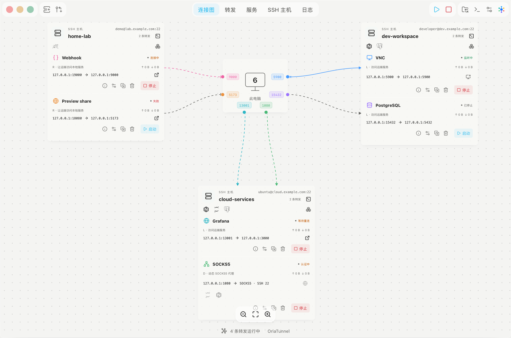
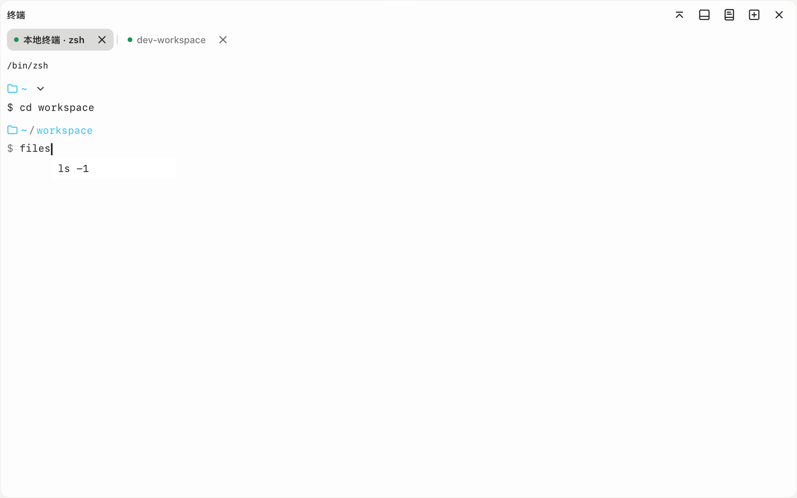

  <picture>
    <source media="(prefers-color-scheme: dark)" srcset="../assets/oriatunnel-logo-dark.svg">
    
  </picture>

<h1 align="center">Un espace de travail SSH pour administrer vos serveurs</h1>

OriaTunnel réunit tunnels SSH, services distants, terminaux, transferts de fichiers et bureaux distants dans une même interface.

  <a href="../../README.md">简体中文</a> · <a href="README.zh-TW.md">繁體中文</a> · <a href="README.en.md">English</a> · <a href="README.ja.md">日本語</a> · <a href="README.ko.md">한국어</a> · <a href="README.de.md">Deutsch</a> · Français · <a href="README.ru.md">Русский</a>

**[Télécharger et installer](#télécharger-et-installer)** · [Prise en main](#prise-en-main) · [Guide utilisateur complet (chinois simplifié)](../USAGE.md) · [Démo en ligne (chinois)](https://oriamade.com/zh-CN/oria-tunnel#workspace)

## Fonctionnalités

### 🔗 Gestion visuelle des tunnels

- La carte montre comment les ports locaux sont reliés aux hôtes SSH. Démarrez ou arrêtez les règles une à une ou par lots et suivez leur état, les connexions actives et le trafic.
- Sélectionnez un hôte dans votre configuration SSH ou ajoutez-le manuellement. Utilisez un mot de passe, une clé privée ou l’agent SSH du système, y compris avec plusieurs hôtes de rebond (ProxyJump).
- Enregistrez une règle pour rouvrir un site interne depuis la carte ou connecter votre client de base de données au port local.

### ⚙️ Services distants

- Enregistrez dans un modèle les commandes de démarrage, d’arrêt, de redémarrage, de consultation de l’état et des journaux. Associez-le à une redirection pour lancer ces actions depuis le menu du service.
- Si le service doit d’abord démarrer, configurez sa commande de démarrage et son contrôle de disponibilité. Suivez le résultat de la commande, du contrôle et de la connexion au tunnel.

### 💻 Terminaux locaux et SSH

- Passez d’une session locale à une session distante grâce aux onglets. Utilisez les suggestions de saisie, appuyez sur ↑ pour retrouver l’historique ou rappelez une commande enregistrée par mot-clé dans toute session.
- Éditez plusieurs lignes avec Maj+Entrée et conservez votre saisie en changeant de répertoire. Repliez les sorties longues et copiez séparément une commande ou son résultat.

### 📁 Transferts de fichiers

- Parcourez les répertoires côte à côte et glissez les fichiers d’un panneau à l’autre pour les envoyer ou les télécharger par lots. Ouvrez deux hôtes SSH pour transférer des fichiers entre eux.
- Suivez chaque lot dans la file d’attente en arrière-plan. Vous pouvez suspendre, reprendre ou annuler une tâche, prévisualiser les fichiers et modifier le texte sur place.

### 🖥️ Bureau distant VNC

- Ouvrez un bureau VNC dans une fenêtre dédiée via un tunnel SSH. Ajustez le zoom, passez en plein écran et copiez du texte dans les deux sens.
- Depuis cette fenêtre, ouvrez un terminal SSH ou transférez des fichiers par SFTP. Les transferts déjà lancés continuent après sa fermeture.

## Télécharger et installer

| Plateforme | Paquet v0.5.0 | Installation |
| --- | --- | --- |
| macOS | [Apple Silicon](https://github.com/KrisLee1/OriaTunnel/releases/download/v0.5.0/OriaTunnel_0.5.0_aarch64.dmg) · [Intel](https://github.com/KrisLee1/OriaTunnel/releases/download/v0.5.0/OriaTunnel_0.5.0_x64.dmg) | Ouvrez l’image disque et glissez OriaTunnel dans Applications. |
| Windows | [x64](https://github.com/KrisLee1/OriaTunnel/releases/download/v0.5.0/OriaTunnel_0.5.0_x64-setup.exe) · [ARM64](https://github.com/KrisLee1/OriaTunnel/releases/download/v0.5.0/OriaTunnel_0.5.0_arm64-setup.exe) | Exécutez le programme d’installation et suivez les instructions. |

### Historique des versions

**v0.5.0** · Divisez le terminal en volets par glisser-déposer et utilisez la saisie assistée de PowerShell sur les hôtes SSH Windows. Le transfert de gros dossiers, la reprise après déconnexion et la réactivité des volets ont été améliorés. Recherchez les mises à jour dans **À propos**.

[Notes de version (chinois)](../releases/v0.5.0.md) · [Toutes les versions](https://github.com/KrisLee1/OriaTunnel/releases)

## Prise en main

Dans cet exemple, un service web est déjà en cours d’exécution sur le port 3000 du serveur SSH.

1. Ouvrez OriaTunnel et choisissez **Ajouter un hôte**. Sélectionnez un hôte détecté dans la configuration SSH ou saisissez ses informations manuellement. La détection lit uniquement la configuration ; elle ne se connecte pas automatiquement.
2. Choisissez **Nouvelle redirection**, l’hôte et la redirection locale (L). Utilisez `127.0.0.1:13000` pour l’écoute locale et `127.0.0.1:3000` pour la cible sur le serveur SSH.
3. Choisissez **Enregistrer et démarrer**, authentifiez-vous lorsque l’application le demande et vérifiez l’empreinte du serveur lors de la première connexion. Dès que la règle indique **En écoute**, ouvrez `http://127.0.0.1:13000` dans votre navigateur local.

La prochaine fois, démarrez la règle enregistrée. Si la page ne s’ouvre pas, vérifiez que le service distant fonctionne sur le port cible. [guide de dépannage (chinois)](../USAGE.md#查看状态与排查问题)

### Choisir un mode de redirection

| Mode | Cas d’utilisation | Accès au service |
| --- | --- | --- |
| **L · Redirection locale** | Accéder depuis cet ordinateur à une application web, une base de données ou un service VNC du serveur | Se connecter à un port d’écoute local qui mène au service distant via SSH |
| **R · Redirection distante** | Permettre à un serveur d’accéder à un service de développement exécuté sur cet ordinateur | Se connecter à un port d’écoute sur le serveur qui mène au service local via SSH |
| **D · Redirection dynamique** | Atteindre plusieurs adresses internes via un hôte SSH | Ouvrir un navigateur proxy distinct depuis le menu, ou configurer un autre client pour SOCKS5 local |

Vous disposez déjà d’un fichier OriaTunnel ? Importez-le depuis la page des redirections, vérifiez son contenu et complétez votre authentification avant de démarrer. Les modèles de service importés nécessitent une vérification et une activation explicites. Voir [utiliser une configuration existante (chinois)](../USAGE.md#使用现成配置).

## Captures d’écran

Ces aperçus en mode clair et sombre utilisent les données d’exemple de la démo OriaTunnel dans OriaMadeWeb.

| <picture><source media="(prefers-color-scheme: dark)" srcset="../assets/screenshots/connection-map-dark.png"></picture> | <picture><source media="(prefers-color-scheme: dark)" srcset="../assets/screenshots/terminal-dark.png"></picture> |
| :---: | :---: |
| <picture><source media="(prefers-color-scheme: dark)" srcset="../assets/screenshots/files-dark.png"></picture> | <picture><source media="(prefers-color-scheme: dark)" srcset="../assets/screenshots/vnc-dark.png"></picture> |

Autres captures d’écran

| <picture><source media="(prefers-color-scheme: dark)" srcset="../assets/screenshots/forwards-dark.png"></picture> | <picture><source media="(prefers-color-scheme: dark)" srcset="../assets/screenshots/services-dark.png"></picture> |
| :---: | :---: |
| <picture><source media="(prefers-color-scheme: dark)" srcset="../assets/screenshots/hosts-dark.png"></picture> | <picture><source media="(prefers-color-scheme: dark)" srcset="../assets/screenshots/logs-dark.png"></picture> |

## Documentation et assistance

[Guide utilisateur complet (chinois simplifié)](../USAGE.md) · [guide de dépannage (chinois)](../USAGE.md#查看状态与排查问题) · [guide de développement (chinois simplifié)](../DEVELOPMENT.md) · [GitHub Issues](https://github.com/KrisLee1/OriaTunnel/issues)

## Licence

Copyright (C) 2026 KrisLee.

OriaTunnel est distribué sous la **GNU General Public License, version 3 uniquement (GPL-3.0-only)**. Le texte intégral figure dans [LICENSE](../../LICENSE).

Ce logiciel est fourni sans aucune garantie, conformément à la licence. Le code, les dépendances et les ressources de tiers conservent leurs licences et mentions respectives. Les textes de licences tiers inclus sont disponibles dans [docs/licenses](../licenses).
