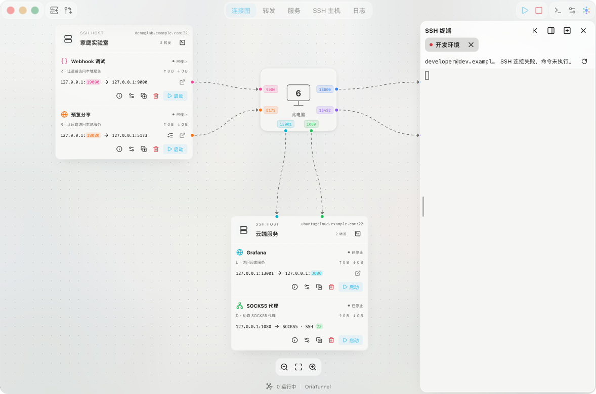
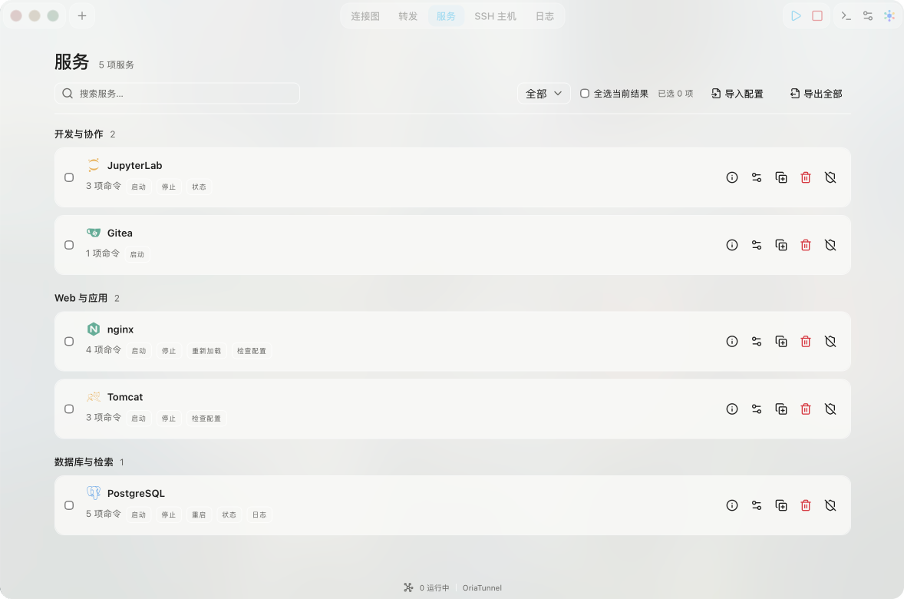

  <picture>
    <source media="(prefers-color-scheme: dark)" srcset="../assets/oriatunnel-logo-dark.svg">
    
  </picture>

SSH トンネルを視覚的に管理し、リモートサービスをもっと手軽に。

  <a href="../../README.md">简体中文</a> · <a href="README.zh-TW.md">繁體中文</a> · <a href="README.en.md">English</a> · 日本語 · <a href="README.ko.md">한국어</a> · <a href="README.de.md">Deutsch</a> · <a href="README.fr.md">Français</a> · <a href="README.ru.md">Русский</a>

OriaTunnel は、Windows と macOS 向けの SSH トンネル・リモートサービス管理ツールです。複数のサーバー、トンネル、サービスを画面上でまとめて管理できます。複雑な転送コマンドを覚えなくても、内部ネットワークのデータベース、Web 管理画面、開発環境に接続し、設定済みのサービス操作を実行できます。

ホストと転送ルールを保存すれば、日常の開始・停止やサービスへのアクセスは画面から操作できます。SSH コマンドに詳しくない方も、管理者や同僚が用意した設定を読み込み、自分の認証情報を設定して利用できます。

現在のバージョン：**v0.1.1** · [更新履歴](#更新履歴)

**[詳しいユーザーガイド（中国語・簡体字）](../USAGE.md)** · [クイックスタート](#クイックスタート) · [転送方式を選ぶ](#転送方式を選ぶ)

## できること

- **複数のトンネルを管理：** ホストごとに接続を確認し、ルールを個別または一括で開始・停止できます。
- **サービス操作をボタンに保存：** 起動・停止・再起動・状態確認・ログ表示などのコマンドを保存し、関連付けた転送から実行できます。組み込みテンプレートも利用できます。
- **必要なときに確認して接続：** 状態・ヘルスチェックを設定し、対応する非対話型の起動処理ではサービス起動と転送接続を組み合わせ、各手順の結果を確認できます。
- **SSH ターミナルを内蔵：** 複数タブの対話型ターミナルに加え、入力や継続的なフォアグラウンド実行が必要なコマンドには専用ターミナルを使えます。
- **一般的な SSH 転送方式に対応：** ローカル転送（L）、リモート転送（R）、動的 SOCKS5 転送（D）と、順序を指定した複数段の ProxyJump を使えます。
- **ホスト設定を再利用：** SSH 設定から候補を検出するか、手動でホストを追加できます。パスワード、秘密鍵、システムの SSH エージェントによる認証に対応しています。
- **動作状況を確認：** 接続状態、待ち受け経路、通信量、アクティブ接続、再接続の進行状況、絞り込み可能なイベントログを確認できます。
- **トンネルを継続して利用：** トレイやメニューバーでのバックグラウンド動作と、ネットワーク障害後の再接続に対応しています。ログイン時の起動や、アプリ起動時に選択したルールを自動接続する設定も利用できます。
- **設定を整理・共有：** 名前、タグ、色、アイコンをカスタマイズし、ホスト、転送、明示的に選択したサービステンプレートを読み込み・書き出しできます。
- **8 言語のインターフェース：** 中国語（簡体字・繁体字）、日本語、韓国語、英語、ドイツ語、フランス語、ロシア語に対応し、ネイティブのエラーメッセージと SSH 設定の診断も翻訳されています。ライト・ダークモードとテーマの設定も使えます。

## ダウンロードとインストール

[Releases のダウンロードページ](https://github.com/KrisLee1/OriaTunnel/releases/tag/v0.1.1)で、お使いの OS とデバイスのアーキテクチャに合ったパッケージを選択してください。

- **Windows：** `.exe` インストーラーをダウンロードし、インストールウィザードに従って進めてください。
- **macOS：** `.dmg` をダウンロードして開き、`OriaTunnel.app` を **アプリケーション**フォルダーにドラッグしてください。`.zip` をダウンロードした場合は、先に中の `.dmg` を展開してください。

| プラットフォーム | ダウンロード |
| --- | --- |
| Windows x64 | [OriaTunnel_0.1.1_x64-setup.exe](https://github.com/KrisLee1/OriaTunnel/releases/download/v0.1.1/OriaTunnel_0.1.1_x64-setup.exe) |
| Windows ARM64 | [OriaTunnel_0.1.1_arm64-setup.exe](https://github.com/KrisLee1/OriaTunnel/releases/download/v0.1.1/OriaTunnel_0.1.1_arm64-setup.exe) |
| macOS Apple Silicon | [OriaTunnel_0.1.1_aarch64.dmg](https://github.com/KrisLee1/OriaTunnel/releases/download/v0.1.1/OriaTunnel_0.1.1_aarch64.dmg) |
| macOS Intel | [OriaTunnel_0.1.1_x64.dmg](https://github.com/KrisLee1/OriaTunnel/releases/download/v0.1.1/OriaTunnel_0.1.1_x64.dmg) |

「このアプリについて」のバージョン更新から確認し、ダウンロードしてインストールできます。起動時の確認は無効にできます。インストール時に SSH 接続が切断されるため、端末での作業を先に保存してください。初回導入や古い開発版には上記のインストーラーを使用してください。[アプリの更新（中国語）](../USAGE.md#应用更新)を参照してください。

インストール後に OriaTunnel を起動し、[クイックスタート](#クイックスタート)に従って SSH ホストを追加し、転送を作成してください。日常的な利用に Node.js、pnpm、Rust は必要ありません。

## クイックスタート

初回設定には SSH アドレス、ポート、ユーザー名、認証方式と、対象サービスのアドレス・ポートが必要です。不明な点は管理者に確認してください。SSH コマンドを覚える必要はありません。以下の例ではサービスがすでに動作しているものとします。

1. OriaTunnel を開き、**「ホストを追加」**を選択します。SSH 設定から検出したホストを選ぶか、接続情報を手動で入力します。検出は設定を読み取るだけで、自動的に接続することはありません。
2. **「新しい転送」**を選択し、ホストと L / R / D を指定して、待ち受け先を入力します。L / R では接続先のアドレスとポートも必要です。
3. **「保存して開始」**を選択し、表示される案内に従って認証します。初回の接続ではサーバーのフィンガープリントを確認してください。
4. **「待ち受け中」**になるまで待ち、ブラウザーやサービスのクライアントから転送先にアクセスします。D ではプロキシブラウザーのメニューを使えます。関連付けたサービスのページも直接開けます。

たとえば、SSH サーバー上の Web アプリにアクセスするには、**L** を選び、待ち受け先を `127.0.0.1:13000`、接続先を `127.0.0.1:3000` に設定します。開始したら、このコンピュータで `http://127.0.0.1:13000` を開きます。ここで接続先の `127.0.0.1` は、**SSH サーバー自身**を指します。この例では、サーバーのポート 3000 で Web アプリが動作していることを前提としています。

**「待ち受け中」**は、転送の入口が準備できたことを示します。実際にサービスを利用できるかどうかは、接続先のアプリ、ネットワーク、アクセス権にも依存します。必要に応じて、[状態の確認とトラブルシューティング（中国語）](../USAGE.md#查看状态与排查问题)をご覧ください。

設定後はマップや転送一覧から保存済みルールを開始します。準備が整った HTTP・HTTPS・VNC の入口は「サービスを開く」から利用でき、データベースには対応クライアントを使います。

OriaTunnel の設定ファイルがある場合は、転送ページから読み込み、内容を確認して自分の認証情報を設定してから開始します。読み込んだサービステンプレートは確認後に実行を有効にする必要があります。[既存の設定を使う（簡体字中国語）](../USAGE.md#使用现成配置)を参照してください。

リモートサービスを操作するには、サービスページでテンプレートを作成または読み込み、コマンドとパスを確認して転送に関連付けます。操作はその転送のサービスメニューから実行します。保存や関連付けだけでは実行されません。[サービステンプレート（簡体字中国語）](../USAGE.md#预设远程命令)を参照してください。

## 転送方式を選ぶ

| 方式 | 用途 | サービスへのアクセス方法 |
| --- | --- | --- |
| **L · ローカル転送** | このコンピュータからサーバー上の Web アプリ、データベース、VNC にアクセスする | ローカルの待ち受けポートに接続すると、SSH 経由でリモートのサービスに届きます |
| **R · リモート転送** | このコンピュータで動く開発用サービスに、サーバーからアクセスする | サーバー上の待ち受けポートに接続すると、SSH 経由でローカルのサービスに届きます |
| **D · 動的転送** | SSH ホストを経由して複数の内部アドレスにアクセスする | メニューから独立したプロキシブラウザーを開くか、別のクライアントに SOCKS5 を設定します |

共有 IP を使い、SSH ポートが 1 つしか割り当てられていないサーバーでも、そのポートを通じて複数のサービスにアクセスできます。[共有 IP の例（中国語）](../USAGE.md#场景四共享-ip只分配一个-ssh-端口)をご覧ください。

## スクリーンショット

接続マップ、転送、サービス、ホスト、ログ、SSH ターミナルのライト・ダーク表示です。独立したサンプルデータを使っており、実際のサーバーや認証情報は含みません。

| <picture><source media="(prefers-color-scheme: dark)" srcset="../assets/screenshots/connection-map-dark.png"></picture> | <picture><source media="(prefers-color-scheme: dark)" srcset="../assets/screenshots/terminal-dark.png"></picture> |
| :---: | :---: |
| <picture><source media="(prefers-color-scheme: dark)" srcset="../assets/screenshots/forwards-dark.png"></picture> | <picture><source media="(prefers-color-scheme: dark)" srcset="../assets/screenshots/services-dark.png"></picture> |
| <picture><source media="(prefers-color-scheme: dark)" srcset="../assets/screenshots/hosts-dark.png"></picture> | <picture><source media="(prefers-color-scheme: dark)" srcset="../assets/screenshots/logs-dark.png"></picture> |

## ユーザードキュメント

[詳しいユーザーガイド（中国語・簡体字）](../USAGE.md)では、ホスト管理、認証、具体的な転送の例、バックグラウンド動作、よくある問題を説明しています。。

- [初回接続と日常の利用](../USAGE.md#第一次连接远程服务)
- [既存の設定を使う](../USAGE.md#使用现成配置)
- [サービステンプレートと操作](../USAGE.md#预设远程命令)
- [状態・ヘルスチェックと起動後の接続](../USAGE.md#服务状态健康检查与启动并连接)
- [SSH 対話型ターミナル](../USAGE.md#ssh-交互终端)
- [SSH ホストの追加と管理（中国語）](../USAGE.md#添加和管理-ssh-主机)
- [転送の作成と管理（中国語）](../USAGE.md#创建和管理转发)
- [L：リモートのサービスにアクセス（中国語）](../USAGE.md#场景一访问服务器上的网页或数据库l) · [R：ローカルのサービスにアクセス（中国語）](../USAGE.md#场景二让服务器访问本机开发服务r) · [D：SOCKS5 プロキシ（中国語）](../USAGE.md#场景三通过-ssh-代理访问多个服务d)
- [設定の読み込みと書き出し（中国語）](../USAGE.md#配置导入与导出)
- [バックグラウンド動作・再接続・自動起動（中国語）](../USAGE.md#后台运行重连与自动启动)
- [状態の確認とトラブルシューティング（中国語）](../USAGE.md#查看状态与排查问题)

## 更新履歴

### v0.1.1 · 2026-10-27

- D 転送からプロキシブラウザーを開き、リモートサービスへ直接アクセスできる入口を追加しました。
- サービスの関連付けと管理、およびリモートサービスへのアクセスを改善しました。
- 接続図の描画性能を改善し、カードの描画問題を修正しました。

### v0.1.0 · 初回バージョン · 2026-10-25

- SSH ホストと L / R / D トンネルの視覚的な管理、多段接続の認証、接続診断。
- 再利用可能なサービステンプレート、コマンド操作、状態・ヘルスチェック、サービス起動と転送接続の組み合わせ。
- 複数タブの SSH ターミナルと、対話型・フォアグラウンドコマンド用の専用ターミナル。
- 設定の読み込み・書き出し、トレイやメニューバーでの動作、トンネルの再接続、8 言語とテーマ設定。

## 利用上の注意

L / R / D は TCP 通信を転送します。D はループバックアドレスでのみ待ち受け、SOCKS5 CONNECT に対応しています。UDP には対応していません。独立した Chrome、Edge、Firefox のプロキシウインドウを開けます。システムプロキシや普段のブラウザー設定は変更しません。Safari には対応していません。ほかのコンピュータから R にアクセスできるかどうかは、サーバーの SSH ポリシー、ファイアウォール、ネットワーク設定に依存します。

既定では、ウィンドウを閉じても転送はトレイやメニューバーで動作を続けます。**「OriaTunnel を終了」**を選ぶと、すべての接続を停止します。自動接続は個別に有効にする設定です。各段のホストが信頼済みで、秘密鍵または SSH エージェントによる認証が可能である必要があり、保存済みパスワードは使用しません。

Windows と macOS では、希望する場合にパスワードをシステムの資格情報ストアに保存できます。書き出した設定に保存済みの認証パスワード、秘密鍵の内容、信頼記録は含まれません。ホストのアドレス、ユーザー名、ポートに加え、サービスを選択した場合はスクリプトと環境変数も含まれるため、共有前に確認してください。詳細は[対応範囲（中国語）](../USAGE.md#当前功能边界)をご覧ください。

サービステンプレートはサーバー上のソフトウェア、パス、権限に合わせて設定します。ソフトウェアのインストールやデプロイは行いません。転送の開始・停止とリモートサービスの操作は別々です。チェックは必要に応じて実行し、バックグラウンドの常時監視は行いません。

開発については、[開発ガイド（中国語・簡体字）](../DEVELOPMENT.md)をご覧ください。

問題がある場合は[トラブルシューティング（簡体字中国語）](../USAGE.md#查看状态与排查问题)を確認し、[GitHub Issues](https://github.com/KrisLee1/OriaTunnel/issues)に再現手順と機密情報を除いた内容を報告してください。

## ライセンス

Copyright (C) 2026 KrisLee.

OriaTunnel は **GNU General Public License 第 3 版のみ（GPL-3.0-only）**で提供されます。全文は [LICENSE](../../LICENSE) を参照してください。

本ソフトウェアは無保証で提供されます。詳細はライセンスを参照してください。サードパーティのコード、依存関係、素材にはそれぞれのライセンスと表示が適用されます。同梱する第三者のライセンスは [docs/licenses](../licenses) にあります。
