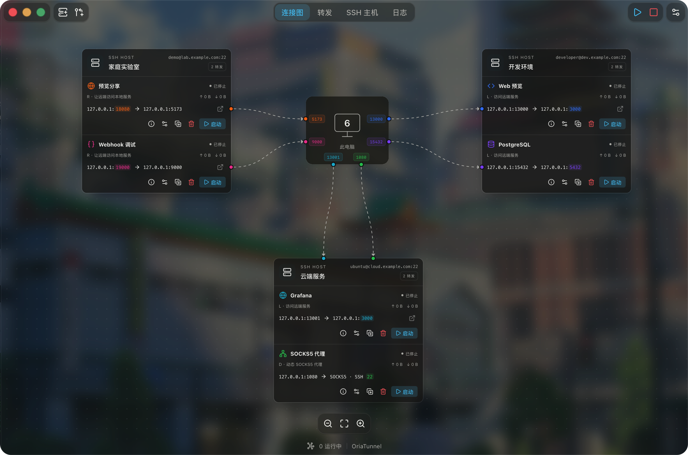
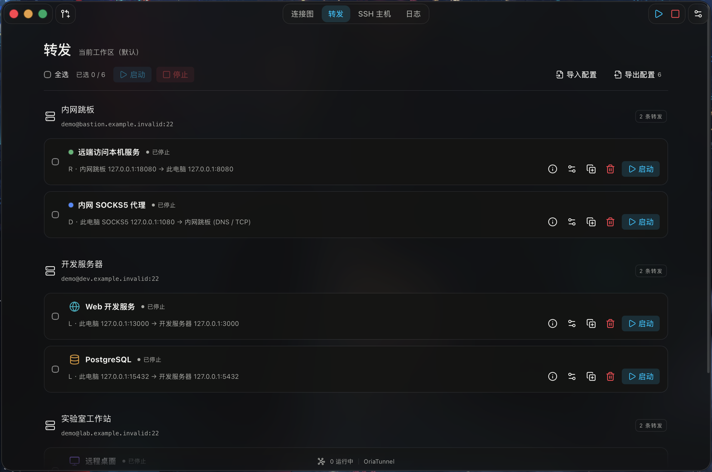
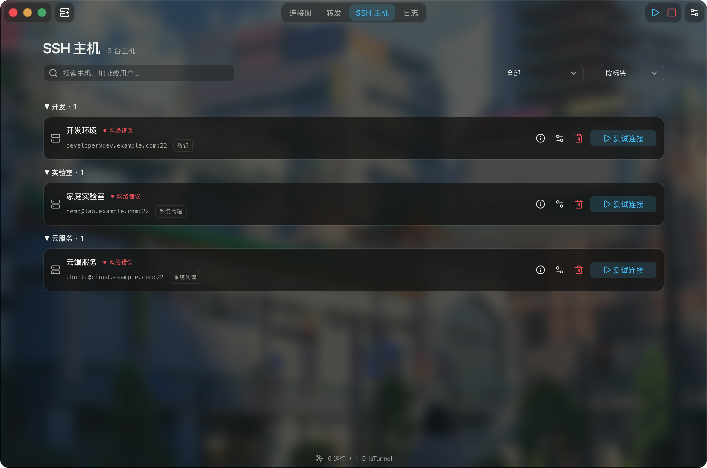
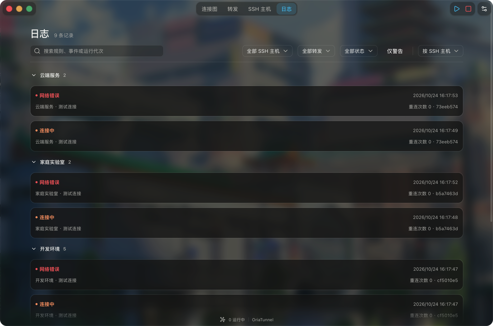

  <picture>
    <source media="(prefers-color-scheme: dark)" srcset="../assets/oriatunnel-logo-dark.svg">
    
  </picture>

在連線圖中管理 SSH 通道，讓遠端服務觸手可及。

  <a href="../../README.md">简体中文</a> · 繁體中文 · <a href="README.en.md">English</a> · <a href="README.ja.md">日本語</a> · <a href="README.ko.md">한국어</a> · <a href="README.de.md">Deutsch</a> · <a href="README.fr.md">Français</a> · <a href="README.ru.md">Русский</a>

OriaTunnel 是適用於 Windows 和 macOS 的 SSH 連接埠轉送桌面工具。透過連線圖和清單，一起查看 SSH 主機、轉送路徑與執行狀態；為資料庫、網站後台、開發服務或遠端桌面儲存可重複使用的連線規則。

**[完整使用指南（簡體中文）](../USAGE.md)** · [快速上手](#快速上手) · [選擇轉送方式](#選擇轉送方式)

## 介面預覽

獨立示範設定：3 台範例主機、6 條 L / R / D 轉送，全部停止，沒有真實伺服器或憑證。

|  |  |
| :---: | :---: |
|  |  |

## 功能特色

- **管理多條通道**：依主機查看連線圖與轉送清單，個別或批次啟動、停止規則。
- **支援常見 SSH 轉送情境**：本機轉送 L、遠端轉送 R、動態 SOCKS5 代理 D，支援依序經過多個跳板的 ProxyJump 路線。
- **沿用既有主機設定**：從 SSH 設定中尋找候選主機，或手動新增；支援密碼、私密金鑰與系統 SSH 代理程式驗證。
- **查看實際執行情況**：連線狀態、監聽路徑、流量、作用中的連線、重新連線進度，以及可篩選的事件記錄。
- **維持通道運作**：在系統匣或選單列於背景執行、網路故障後自動重新連線，並可選擇登入時自動啟動或在應用程式啟動時連線指定規則。
- **整理與移轉設定**：自訂名稱、標籤、色彩與圖示，匯入或匯出連線規則。
- **8 種介面語言**：簡體中文、繁體中文、日文、韓文、英文、德文、法文、俄文，包含原生錯誤訊息與 SSH 來源診斷；支援淺色、深色與主題設定。

## 選擇轉送方式

| 方式 | 適用情境 | 使用方式 |
| --- | --- | --- |
| **L · 本機轉送** | 在這部電腦存取伺服器上的網站、資料庫或 VNC | 存取本機監聽連接埠，透過 SSH 連線至遠端服務 |
| **R · 遠端轉送** | 讓伺服器存取這部電腦上的開發服務 | 在伺服器端存取監聽連接埠，透過 SSH 連線至本機服務 |
| **D · 動態代理** | 透過 SSH 主機存取多個內部網路位址 | 將瀏覽器或其他用戶端設定為使用本機 SOCKS5 代理 |

如果伺服器使用共用 IP，僅分配了一個 SSH 連接埠，仍可透過該連接埠存取伺服器上的多個服務。請參閱[共用 IP 範例（簡體中文）](../USAGE.md#场景四共享-ip只分配一个-ssh-端口)。

## 快速上手

準備 SSH 主機位址、連接埠、使用者名稱與驗證方式，並確認要存取的服務已在執行。

1. 開啟 OriaTunnel，選擇「新增主機」，從 SSH 設定中找到的主機中選取，或手動填寫連線資訊。尋找主機只會讀取設定，不會自動連線。
2. 選擇「新增轉送」，選擇主機與 L / R / D，再填寫監聽位址及連接埠；L / R 還需填寫目標位址與連接埠。
3. 選擇「儲存並啟動」，依提示完成驗證，並在首次連線時核對伺服器指紋。
4. 等待規則顯示「監聽中」，再於瀏覽器或服務用戶端中使用轉送入口。D 需要先在用戶端設定 SOCKS5 代理。

例如，要存取 SSH 伺服器上的網站服務，可選擇 **L**，將本機監聽設為 `127.0.0.1:13000`，目標設為 `127.0.0.1:3000`。啟動後，在這部電腦開啟 `http://127.0.0.1:13000`。此處目標的 `127.0.0.1` 指的是 **SSH 伺服器本身**；範例假設網站服務在伺服器的 3000 連接埠執行。

「監聽中」表示轉送入口已就緒；服務是否可用仍取決於目標服務、網路與存取權限。遇到問題時，請查看[狀態與疑難排解（簡體中文）](../USAGE.md#查看状态与排查问题)。

## 下載與安裝

前往 [Releases 下載頁面](https://github.com/KrisLee1/OriaTunnel/releases)，選擇適合你的作業系統與裝置架構的套件。

- **Windows：**下載 `.exe` 安裝程式，依安裝精靈的指示完成安裝。
- **macOS：**下載並開啟 `.dmg`，將 `OriaTunnel.app` 拖入「**應用程式（Applications）**」。若下載的是 `.zip`，請先解壓縮其中的 `.dmg`。

安裝後啟動 OriaTunnel，再依[快速上手](#快速上手)新增 SSH 主機並建立轉送。日常使用不需要 Node.js、pnpm 或 Rust。

## 使用文件

[完整使用指南（簡體中文）](../USAGE.md)說明主機管理、驗證、各種轉送的完整範例、背景執行與常見問題：

- [新增與管理 SSH 主機（簡體中文）](../USAGE.md#添加和管理-ssh-主机)
- [建立與管理轉送（簡體中文）](../USAGE.md#创建和管理转发)
- [L：存取遠端服務（簡體中文）](../USAGE.md#场景一访问服务器上的网页或数据库l) · [R：存取本機服務（簡體中文）](../USAGE.md#场景二让服务器访问本机开发服务r) · [D：SOCKS5 代理（簡體中文）](../USAGE.md#场景三通过-ssh-代理访问多个服务d)
- [設定匯入與匯出（簡體中文）](../USAGE.md#配置导入与导出)
- [背景執行、重新連線與自動啟動（簡體中文）](../USAGE.md#后台运行重连与自动启动)
- [狀態與疑難排解（簡體中文）](../USAGE.md#查看状态与排查问题)

## 使用須知

L / R / D 均轉送 TCP 流量。D 僅監聽本機迴路位址，支援 SOCKS5 CONNECT，不支援 UDP，也不會自動修改系統或瀏覽器的代理設定。能否從其他電腦存取 R，取決於伺服器的 SSH 原則、防火牆與網路設定。

預設關閉視窗後，轉送會繼續在系統匣或選單列執行；選擇「結束 OriaTunnel」會停止全部連線。自動連線是獨立的選用設定，要求每一跳的主機都已受信任，且可透過私密金鑰或系統 SSH 代理程式驗證；不會使用已儲存密碼。

在 Windows 與 macOS 中，可自行選擇將密碼儲存在系統認證儲存區。匯出的設定不含密碼、私密金鑰內容或信任記錄，但仍包含主機位址、使用者名稱與連接埠，分享前請先確認內容。詳細資訊請參閱[功能限制（簡體中文）](../USAGE.md#当前功能边界)。

繼續開發請參閱[開發指南（簡體中文）](../DEVELOPMENT.md)。
