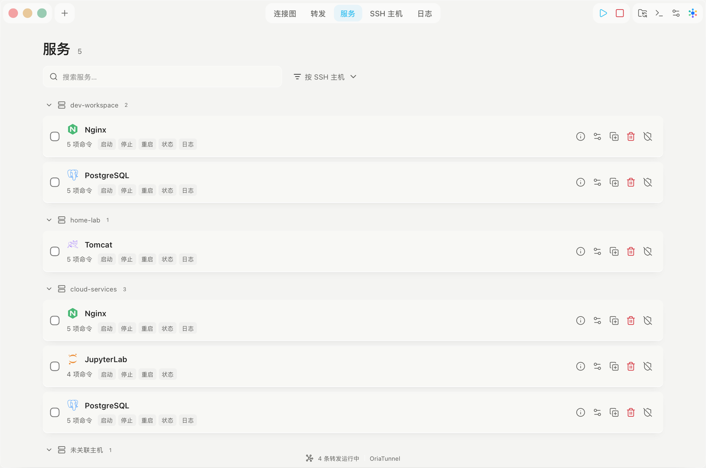
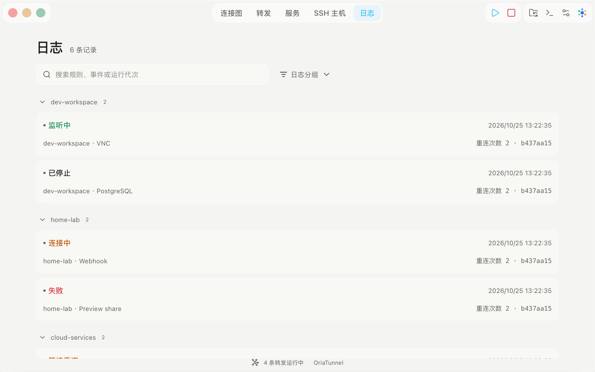

  <picture>
    <source media="(prefers-color-scheme: dark)" srcset="../assets/oriatunnel-logo-dark.svg">
    
  </picture>

<h1 align="center">一個 SSH 工作區，讓遠端管理更簡單</h1>

OriaTunnel 將 SSH 通道、遠端服務、終端機、檔案傳輸與遠端桌面整合在同一個視覺化工作區。

  <a href="../../README.md">简体中文</a> · 繁體中文 · <a href="README.en.md">English</a> · <a href="README.ja.md">日本語</a> · <a href="README.ko.md">한국어</a> · <a href="README.de.md">Deutsch</a> · <a href="README.fr.md">Français</a> · <a href="README.ru.md">Русский</a>

**[下載與安裝](#下載與安裝)** · [快速上手](#快速上手) · [完整使用指南（簡體中文）](../USAGE.md) · [線上示範（簡體中文）](https://oriamade.com/zh-CN/oria-tunnel#workspace)

## 功能特色

### 🔗 視覺化通道管理

- 在連線圖上查看本機、SSH 主機與轉送連接埠的關係。規則可個別或批次啟停，並可即時查看連線狀態、使用中的連線數與流量。
- 從既有的 SSH 設定中選取主機，或手動新增。支援密碼、私密金鑰、系統 SSH Agent 與多層跳板連線（ProxyJump）。
- 儲存常用規則後，下次即可從連線圖開啟內部網頁，或用本機資料庫用戶端連上轉送連接埠。

### ⚙️ 遠端服務管理

- 將啟動、停止、重新啟動、查詢狀態與檢視日誌的指令儲存為範本。範本與轉送關聯後，即可從服務選單執行。
- 若需先啟動服務，可設定啟動指令與健康檢查。使用「啟動並連線」時，可逐步查看遠端指令、服務檢查與通道連線的結果。

### 💻 本機與 SSH 智慧終端機

- 透過分頁切換本機與遠端工作階段。輸入時可查看補全建議，按 ↑ 找回歷史指令，或輸入關鍵字，從跨工作階段共用的指令庫叫出常用指令。
- 按 Shift+Enter 編輯多行指令，切換目錄仍會保留草稿。執行後可摺疊較長的輸出，或單獨複製指令與執行結果。

### 📁 視覺化檔案傳輸

- 將本機與遠端目錄並排開啟，在兩個面板間拖放檔案即可批次上傳或下載。也可以分別開啟兩台 SSH 主機，在主機間傳輸檔案。
- 從背景佇列查看每批檔案的進度，暫停、繼續或取消工作。也可直接預覽檔案或編輯文字。

### 🖥️ VNC 遠端桌面

- 從 VNC 轉送開啟獨立視窗，透過 SSH 通道操作遠端桌面。支援全螢幕、縮放，以及本機與遠端之間的雙向文字剪貼簿。
- 在桌面視窗中開啟 SSH 終端機，或透過 SFTP 收發檔案。關閉視窗後，已加入佇列的傳輸仍會繼續執行。

## 下載與安裝

| 平台 | 安裝檔 v0.4.1 | 安裝方式 |
| --- | --- | --- |
| macOS | [Apple Silicon](https://github.com/KrisLee1/OriaTunnel/releases/download/v0.4.1/OriaTunnel_0.4.1_aarch64.dmg) · [Intel](https://github.com/KrisLee1/OriaTunnel/releases/download/v0.4.1/OriaTunnel_0.4.1_x64.dmg) | 開啟磁碟映像檔，將 OriaTunnel 拖入「應用程式」。 |
| Windows | [x64](https://github.com/KrisLee1/OriaTunnel/releases/download/v0.4.1/OriaTunnel_0.4.1_x64-setup.exe) · [ARM64](https://github.com/KrisLee1/OriaTunnel/releases/download/v0.4.1/OriaTunnel_0.4.1_arm64-setup.exe) | 執行安裝程式，依畫面提示完成安裝。 |

### 版本記錄

**v0.4.1** · 新增終端機組合面板，可拖放分割窗格，改善終端機縮放卡頓並加快大量檔案的續傳。已安裝的使用者可在「關於」中檢查更新。

[本版更新說明（簡體中文）](../releases/v0.4.1.md) · [所有版本](https://github.com/KrisLee1/OriaTunnel/releases)

## 快速上手

假設網頁服務已在 SSH 伺服器的 3000 連接埠執行，透過以下三步即可從本機存取。

1. 開啟 OriaTunnel，選擇「新增主機」，從 SSH 設定中找到的主機中選取，或手動填寫連線資訊。尋找主機只會讀取設定，不會自動連線。
2. 選擇「新增轉送」、主機與「本機轉送（L）」。本機監聽位址填入 `127.0.0.1:13000`，目標填入 SSH 伺服器本身的 `127.0.0.1:3000`。
3. 選擇「儲存並啟動」，依提示完成驗證，並在首次連線時核對伺服器指紋。 規則顯示「監聽中」後，在本機瀏覽器開啟 `http://127.0.0.1:13000`。

下次直接啟動已儲存的規則即可。若網頁無法開啟，請檢查遠端服務是否已在目標連接埠執行。 [疑難排解（簡體中文）](../USAGE.md#查看状态与排查问题)

### 選擇轉送方式

| 方式 | 適用情境 | 使用方式 |
| --- | --- | --- |
| **L · 本機轉送** | 在這部電腦存取伺服器上的網站、資料庫或 VNC | 存取本機監聽連接埠，透過 SSH 連線至遠端服務 |
| **R · 遠端轉送** | 讓伺服器存取這部電腦上的開發服務 | 在伺服器端存取監聽連接埠，透過 SSH 連線至本機服務 |
| **D · 動態代理** | 透過 SSH 主機存取多個內部網路位址 | 從選單開啟獨立代理瀏覽器，或為其他用戶端設定本機 SOCKS5 代理 |

已有 OriaTunnel 設定檔時，可在轉送頁選擇「匯入設定」，預覽後補齊本機驗證資訊，再手動啟動。匯入的服務範本需先核對並啟用執行。詳見[使用現成設定（簡體中文）](../USAGE.md#使用现成配置)。

## 介面預覽

以下功能介面取自 OriaMadeWeb 的 OriaTunnel 示範，使用範例資料，會依閱讀主題切換淺色或深色。

| <picture><source media="(prefers-color-scheme: dark)" srcset="../assets/screenshots/connection-map-dark.png"></picture> | <picture><source media="(prefers-color-scheme: dark)" srcset="../assets/screenshots/terminal-dark.png"></picture> |
| :---: | :---: |
| <picture><source media="(prefers-color-scheme: dark)" srcset="../assets/screenshots/files-dark.png"></picture> | <picture><source media="(prefers-color-scheme: dark)" srcset="../assets/screenshots/vnc-dark.png"></picture> |

更多介面

| <picture><source media="(prefers-color-scheme: dark)" srcset="../assets/screenshots/forwards-dark.png"></picture> | <picture><source media="(prefers-color-scheme: dark)" srcset="../assets/screenshots/services-dark.png"></picture> |
| :---: | :---: |
| <picture><source media="(prefers-color-scheme: dark)" srcset="../assets/screenshots/hosts-dark.png"></picture> | <picture><source media="(prefers-color-scheme: dark)" srcset="../assets/screenshots/logs-dark.png"></picture> |

## 文件與支援

[完整使用指南（簡體中文）](../USAGE.md) · [疑難排解（簡體中文）](../USAGE.md#查看状态与排查问题) · [開發指南（簡體中文）](../DEVELOPMENT.md) · [GitHub Issues](https://github.com/KrisLee1/OriaTunnel/issues)

## 授權條款

Copyright (C) 2026 KrisLee.

OriaTunnel 採用 **GNU General Public License v3.0 only（GPL-3.0-only）**，僅適用第 3 版。完整條款請見 [LICENSE](../../LICENSE)。

本軟體不提供任何擔保，詳見授權條款。第三方程式碼、相依套件與資源仍適用各自的授權及聲明；隨附的第三方授權請見 [docs/licenses](../licenses)。
